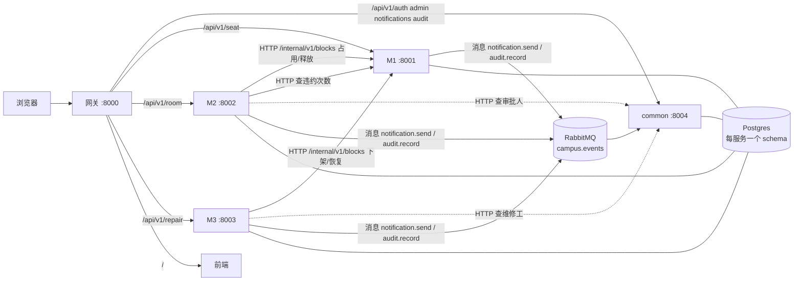

# 校园资源服务平台

以自习座位预约为核心，覆盖整教室申请审批与物业报修的校园资源平台。复旦大学《软件过程管理与工程伦理》课程实践项目。

本文是项目的整体设计。各模块的详细设计见 [`docs/design/`](docs/design/)，开发流程见 [`docs/process.md`](docs/process.md)，AI 协作规则见 [`AGENTS.md`](AGENTS.md)。

---

## 1. 系统组成

| 服务 | 目录 | 端口 | 负责人 | 职责 |
|---|---|---|---|---|
| common | `services/common` | 8004 | D（RBAC）、F（通知、审计） | 登录与 JWT 签发、用户/角色/权限/院系、站内通知与邮件、操作审计 |
| M1 自习座位预约 | `services/m1-seat` | 8001 | A（后端）、B（前端、提醒、统计） | 空间与座位主数据、搜索、预约、签到、违约、提醒；**座位状态的唯一写入方** |
| M2 整教室预约与审批 | `services/m2-room` | 8002 | C（申请、审批）、D（门槛、配置） | 资格门槛、申请、多级审批、超时撤销；审批通过后经 M1 占用教室 |
| M3 物业报修工单 | `services/m3-repair` | 8003 | E（工单）、F（通知集成） | 上报、派单、维修中、超时升级、验收评价；维修中经 M1 下架教室 |
| 前端 | `frontend` | 3000（开发） | B（core 与 M1 页面）、各模块组（各自页面） | Vue 3 单页应用，按模块分目录，见 [`docs/design/frontend.md`](docs/design/frontend.md) |
| 网关 | `deploy/gateway` | 8000 | E | 唯一对外入口，按路径转发，不转发 `/internal` |

公共层 D 的归属：拆成独立的 common 服务，由 M2 组的 D 和 M3 组的 F 分别负责 RBAC 与通知审计；空间与座位主数据归 M1。理由与备选方案见 [ADR-001](docs/adr/001-公共层归属.md)。



## 2. 技术栈

| 层面 | 选型 | 说明 |
|---|---|---|
| 后端 | Python 3.12、FastAPI、Pydantic v2 | 路由和模型即接口文档，`/docs` 自动生成 |
| 前端 | Vue 3、TypeScript、Vite、Element Plus、openapi-fetch | 接口类型从契约生成，模块目录与后端服务同名 |
| 数据库 | PostgreSQL 16、SQLAlchemy 2（psycopg 3）、Alembic | API 用异步会话，worker 与迁移用同步会话 |
| 消息与任务 | RabbitMQ、Celery（worker + beat）、FastStream（消费者）、Redis（锁） | 见第 5 节 |
| 包管理 | uv workspace，单一 `uv.lock` | 四个服务和公共库版本一致 |
| 质量 | pytest、pytest-cov、ruff、mutmut（变异测试）、oasdiff（契约破坏性检查） | |
| 交付 | Docker、Docker Compose、GitHub Actions、GHCR 镜像仓库 | |

## 3. 接口约定

所有服务遵守同一套约定，由公共库 [`libs/campus_common`](libs/campus_common/src/campus_common) 实现，业务代码直接调用：

| 项目 | 约定 | 公共库入口 |
|---|---|---|
| 路径 | 对外 `/api/v1/<模块>/...`（经网关）；服务间 `/internal/v1/...`（只在 Docker 内网可达） | — |
| 时间 | 接口用带时区的 ISO 8601，数据库用 `timestamptz`，业务时区 `Asia/Shanghai` | `timeutil.now()`、`AwareDatetime` |
| 错误 | `{code, message, details, request_id}`，调用方按 `code` 判断 | `raise AppError(409, "SEAT_NOT_AVAILABLE", "...")` |
| 分页 | `?page=1&size=20` → `{items, total, page, size}` | `Page[T]`、`page_params` |
| 链路追踪 | 网关生成 `X-Request-ID`，服务间调用、消息、审计日志原样透传 | `app_factory` 中间件 |
| 幂等 | 服务间写操作带 `Idempotency-Key`，格式 `<模块>-<实体>-<id>-<动作>` | 调用方 `clients.idempotency_key()`；提供方 `run_idempotent()` |
| 服务间调用 | 调用方只写业务语义，通信、桩数据（`STUB_CLIENTS`）、宽容读取由公共客户端完成；契约测试对照 `contracts/openapi` 校验 | `clients.m1.M1Client`、`clients.common.CommonClient` |
| 定时任务 | 扫描函数 `fn(session, at)`，注册即调度，任务名 `<模块>.<函数名>` | `worker.ServiceWorker` |
| 系统参数 | 有可调参数的服务（M1、M2、M3）各一张键值表，结构与默认值由参数模型定义 | `ParamMixin`、`params.*` |
| 种子数据 | `seed_base`（所有环境）+ `seed_demo`（`SEED_DEMO=true`），幂等 | `seeding.run_seed()` |
| 测试 | 通用 fixture `client` / `migrated` / `db` / `db_seed`；只连接 `*_test` 库 | pytest 插件、`testing.*` |
| 运维 | 每个服务提供 `GET /health`（存活）、`GET /ready`（数据库可用）、`GET /version`；网关映射为 `/ops/<服务>/<health\|ready\|version>` | `create_app()` |

模块之间的共性能力只在公共库实现一次，服务里不重复编写；完整对照表见 [`AGENTS.md`](AGENTS.md)"公共函数优先"。

接口契约的快照在 [`contracts/`](contracts/)：`openapi/*.json` 由代码自动导出，`events/` 是跨模块消息。CI 会检查代码与快照是否一致、是否有破坏性变更。

## 4. 鉴权

**用户**：common 校验用户名密码后签发 JWT（HS256，有效期 8 小时）。各服务用同一个 `JWT_SECRET` 在本地校验，不回调 common。token 内容：

```json
{"sub": "1", "username": "student", "name": "演示学生", "dept_id": 1,
 "roles": ["student"], "perms": ["seat:reserve", "room:apply", "repair:report"], "exp": 1760007200}
```

服务按**权限码**判断（`Depends(require_perm("seat:reserve"))`），不按角色名判断，因为管理员可以新建角色。权限码目录与预置角色在 [`services/common/app/permissions.py`](services/common/app/permissions.py)。

**服务间**：`/internal/v1/*` 只接受 `X-Service-Name` + `X-Service-Key`，被调用方按白名单放行（`Depends(require_service("m2-room", "m3-repair"))`）。

**数据库**：每个服务使用独立的数据库角色，只拥有自己的 schema（`common`/`m1`/`m2`/`m3`）。访问别的模块的表会被 Postgres 直接拒绝。

## 5. 通信、定时任务与一致性

### 5.1 同步与异步的划分

| 类型 | 方式 | 场景 |
|---|---|---|
| 命令：调用方需要立即知道结果 | 同步 HTTP + 幂等键 | M2/M3 → M1 占用与释放教室；查询教室、违约次数、按权限查用户 |
| 事件：通知别人发生了什么 | RabbitMQ 消息 | 发通知、记审计、领域事件 |
| 定时：到点执行 | Celery Beat 触发扫描任务 | 提醒、未签到取消、审批超时、工单超时升级、outbox 投递、邮件发送 |

### 5.2 三条状态写回链路

| 链路 | 触发 | 调用 | 回滚 |
|---|---|---|---|
| M3 → M1 维修下架 | 维修工开始维修，且派单时勾选了 `blocks_room` | `POST /internal/v1/blocks {source: M3_MAINTENANCE, ref_id: 工单号, end_at: null}` | 验收通过时 `DELETE /internal/v1/blocks/M3_MAINTENANCE/{工单号}` |
| M2 → M1 整室占用 | 最后一级审批通过 | `POST /internal/v1/blocks {source: M2_OCCUPY, ref_id: 申请号, start_at, end_at}` | 撤销或取消时 `DELETE /internal/v1/blocks/M2_OCCUPY/{申请号}` |
| 写入来源追溯 | 每次座位状态变化 | M1 写 `seat_status_logs(source, ref_id)` | `GET /api/v1/seat/seats/{id}/status-history` |

失败处理：调用方先调 M1，成功后才提交本地状态变更；M1 失败则本地不变：M1 不可达或拒绝服务间调用时返回 502（`UPSTREAM_UNAVAILABLE` / `UPSTREAM_ERROR`），M1 的业务错误（400/404/409，如 `SEAT_NOT_AVAILABLE`）原样返回。幂等键保证重试安全。占用时段内已有的个人预约由 M1 自动取消、通知学生、不记违约（[ADR-006](docs/adr/006-占用冲突时个人预约的处理.md)）。

### 5.3 消息可靠性

```
业务事务 ─┬─ 修改业务数据
          └─ 写入本服务 outbox 表（同一事务）
                 ↓  Beat 每 2 秒触发投递（SKIP LOCKED 抢行，publisher confirm 后才标记已发送）
          RabbitMQ topic exchange campus.events ──路由不到──► 备用交换机 → campus.events.unrouted
                 ↓
common 消费者 → inbox 表按 message_id 去重（与业务写入同一事务）→ ack
                 ↓  处理失败按错误分类
                 ├─ 永久错误（消息不合法、违反约束）→ 死信队列 campus.dlq.<队列名>
                 ├─ 临时错误（数据库/网络不可用）→ 进程内快速重试 → <队列名>.retry.<N>s 延迟重试
                 │     （5s→30s→2m→10m→30m…，约 4 小时），到期自动回到原队列
                 └─ 未知错误 → 延迟重试 3 次后进死信队列
```

拓扑（交换机、队列、绑定、重试与死信队列、领域事件存档队列、备用交换机 policy）由 [`campus_common/topology.py`](libs/campus_common/src/campus_common/topology.py) 统一定义：部署时一次性容器 `mq-setup` 执行 `python -m campus_common.mqctl setup`（开发环境由 `make mq-setup` 执行，`make run` / `worker` / `beat` / `consumer` 启动前会自动运行它），生产者首次发布前、消费者启动前也各声明一次，因此任何启动顺序都不会因为"队列还不存在"丢消息。运维命令（查看积压、重放死信、找回未路由消息）见 [`mqctl`](libs/campus_common/src/campus_common/mqctl.py)，决策见 [ADR-010](docs/adr/010-消息拓扑与失败重试.md)。

### 5.4 定时任务

所有定时任务采用"扫描数据库 + `FOR UPDATE SKIP LOCKED` 抢行 + 状态条件更新"，不给单条预约挂延时任务。参考实现：[`services/m1-seat/app/jobs.py`](services/m1-seat/app/jobs.py) 的 `mark_no_shows`。扫描函数在各服务的 `app/worker.py` 中用 `ServiceWorker.scan()` 注册，outbox 投递任务由 `ServiceWorker` 自动注册。

| 服务 | 任务 | 频率 |
|---|---|---|
| common | 发送待发邮件 | 10 秒 |
| M1 | 开始前提醒、开始后未签到再提醒、超时未签到取消并记违约、已结束预约标记完成 | 1 分钟 / 5 分钟 |
| M2 | 审批超时自动撤销 | 1 分钟 |
| M3 | 派单/维修/验收超时升级 | 5 分钟 |
| M1/M2/M3 | outbox 投递 | 2 秒 |

每个服务的 Celery 任务走自己的队列（队列名 = 服务名），互不消费。每个环境每个服务只部署一个 Beat；任务另有 Redis 锁防止同一扫描并发执行。

### 5.5 并发冲突由数据库兜底

| 场景 | 保证手段 |
|---|---|
| 两人同时抢同一座位同一时段 | 排除约束 `no_seat_overlap`（gist，`tstzrange` 重叠即拒绝） |
| 同一人同一时段预约两个座位 | 排除约束 `no_user_overlap` |
| 签到与自动取消同时发生 | 行锁 + 状态条件，只有一方成功 |
| 审批通过与超时撤销同时发生 | `version` 乐观锁 |
| 占用接口被网络重试重复调用 | 幂等键表 + 事务级咨询锁；`room_blocks (source, ref_id)` 唯一 |
| 同一条消息重复投递 | inbox 表 `message_id` 主键 |

## 6. 数据与迁移

- 每个服务一个 schema，Alembic 版本表也在各自 schema 里（`m1.alembic_version`），四个服务独立演进。
- 迁移编号顺序递增（`0001`、`0002`…），用 `make migration svc=m1-seat rev=0002 msg="..."` 生成后人工审查。
- 迁移遵循"先扩展后收缩"：新增列先可空或带默认值，删除旧列放到下一个版本。这样回滚到上一版镜像时，旧代码仍能在新 schema 上运行。
- 种子数据在 `app/seed.py`，每次部署自动执行，必须幂等。基础数据（权限码、预置角色、系统参数）所有环境都写；演示数据（测试账号、演示教室）只在 `SEED_DEMO=true` 的环境写。
- CI 对每个服务验证：空库一次重放到最新、模型与迁移一致（`alembic check`）、可回退再重放、种子连续执行两次结果不变。

## 7. 环境与部署

| 环境 | 位置 | 入口 | 部署方式 |
|---|---|---|---|
| 开发 | 个人电脑 | `localhost:8000`（网关）或 `localhost:800x` | Docker 只跑依赖（含测试库 `campus_test`），服务在 IDE 中运行 |
| 测试 | 测试服务器 | `<测试机>:8000`（单服务器方案为 `:18000`） | 合并到 main 后自动部署 |
| 生产 | 生产服务器 | `<生产机>:8000` | 推送 `v*` 标签，人工审批后部署 |

三类 Docker 配置：

| 文件 | 用途 |
|---|---|
| `deploy/docker-compose.dev.yml` | 开发：Postgres（含 `campus_test`）、Redis、RabbitMQ、Mailpit、开发网关（转发到本机 8001–8004 和 3000）；端口只绑定 127.0.0.1 |
| `services/<服务>/Dockerfile` | 每个服务一个镜像；同一镜像按启动参数运行 `api` / `worker` / `beat` / `consumer` / `migrate` / `mq-setup` |
| `deploy/docker-compose.yml` | 测试与生产：全部依赖 + 各服务进程 + 前端 + 网关；只有网关对外开放端口 |

部署规范（决策见 [ADR-011](docs/adr/011-部署与运维基线.md)）：

| 方面 | 做法 |
|---|---|
| 配置与密钥 | 非敏感配置在 `deploy/env/<环境>.env`；密钥清单与默认值在仓库根目录的 `.env.example`（进入版本管理），需要修改时复制为 `.env`（不进入版本管理）。`scripts/deploy.sh` 按"同名环境变量（流水线中来自 GitHub 环境 secrets）> `.env` > `.env.example`"取值，与环境配置合成服务器上的 `.env`（值按原样传入，权限 600）。密码有一套简单的默认值；JWT 签名密钥与服务间密钥默认留空，部署时在服务器上生成随机值并保留；SMTP 密码等外部服务密钥留空表示不使用。因此不配置任何密钥也能部署。compose 对必需变量使用 `${VAR:?}` |
| 最小权限 | 每个服务独立的数据库角色；RabbitMQ 业务进程使用业务账号（无管理权限，只能声明平台自己的队列与交换机），管理员账号只给一次性容器 `mq-setup`；每个进程只拿到自己需要的配置与密钥（如 JWT 密钥只给 api，SMTP 密码只给 common-worker，api 只持有允许调用自己 `/internal` 接口的服务密钥）；容器以非 root 用户运行；流水线令牌按任务授予最小权限，发到服务器的令牌只能拉取镜像 |
| 启动顺序 | Postgres/Redis/RabbitMQ 健康 → `mq-setup` 完成（消息拓扑、policy、业务账号）→ 各 api 就绪（迁移、种子、`/ready`）→ worker/beat/consumer → 网关 |
| 健康检查 | api 用 `/ready`；worker 用 `celery inspect ping`；consumer 用 `/health`（broker 连接 + 拓扑自检）；前端与网关用 `/healthz`。健康状态用于启动顺序、部署等待与排查，Docker 不会因"不健康"重启容器；进程退出才会由重启策略拉起——consumer 在订阅失效时主动退出，beat 退出即容器退出 |
| 网关 | 路由表 `deploy/gateway/gateway.conf` 各环境共用；部署环境的上游按 Docker DNS 动态解析，api 容器重建后无需重启网关；以网关看到的对端地址作为 `X-Forwarded-For`，只接受格式合法的 `X-Request-ID`；隐藏版本号并添加基本安全响应头 |
| 镜像 | 基础镜像与中间件固定到补丁版本，Dependabot 每周提升级 PR；RabbitMQ 固定主机名，容器重建不丢数据；日志按 20MB × 5 轮转 |
| 邮件 | 测试环境启用 `mailcatcher` profile，邮件进入 Mailpit（界面只绑定服务器本机，经 SSH 隧道查看）；生产环境填写 `SMTP_*` 接入真实 SMTP，`SMTP_HOST` 为空表示只发站内信 |
| 回滚 | 迁移遵循"先扩展后收缩"；api 启动时若数据库版本比镜像新则跳过迁移并告警（`campus_common.migrate`），旧镜像直接在新 schema 上运行 |
| 备份 | 每次部署前与每日 03:00（`server_init.sh` 安装的 cron）执行 `deploy/backup.sh`，`pg_dump` 写入部署目录的 `backups/`，保留最近 14 份；恢复命令见脚本注释 |
| 初始账号 | 所有环境写入引导管理员 `admin`（密码 `ADMIN_PASSWORD`，默认 `campus123`），用于新环境登录后创建其他用户；开发与测试环境另有各角色的演示账号（`SEED_DEMO=true`，密码 `DEMO_PASSWORD`，默认 `campus123`），集成测试读取同一个值 |

单服务器方案：测试环境使用 `deploy/env/test-single-server.env`（端口 +10000），compose 项目名不同（`campus-test` / `campus-prod`），数据卷互相隔离。

## 8. CI/CD

```
feature 分支 push / PR ──► ci.yml（各任务并行，ci-passed 汇总）
    lint（ruff、shell 检查）
    test × 4 服务（各用自己的数据库角色：迁移重放、alembic check、回退重放、种子幂等、pytest + 覆盖率）
    test-lib（公共库，含跨模块客户端契约测试）
    contract（契约漂移；PR 上另查破坏性变更，标签变化会重新触发）
    frontend（类型与契约一致、lint、构建）
    docker-build
        └─► ci-passed ── 分支保护：ci-passed 通过 + 1 人批准 + CODEOWNERS 批准，只允许 squash 合并
        ▼
合并到 main ──► deploy-test.yml（并发组 deploy-test：同一时间只有一次部署或集成测试）
    CI → 构建并推送镜像（标签 = 提交号）→ 部署测试环境 → 跨模块集成测试 → 镜像加 verified-<提交号> 标签
        ▼
发布负责人推送 v1.2.0 标签 ──► deploy-prod.yml
    校验：已配置审批人、提交在 main 上、镜像带 verified 标签 → 打版本标签（不重新构建）
    → 等待审批 → 部署前备份 → 部署生产 → 校验运行版本与提交 → 创建 Release（列出包含的 PR）
回滚：Actions 页面从 main 手动运行 deploy-prod.yml，填入要回到的已发布版本（同样需要审批）
```

部署通过 SSH 进行，服务器指纹来自 `DEPLOY_KNOWN_HOSTS` 密钥（事先核对），不在部署时临时信任。`v*` 标签只有仓库管理员（发布负责人）能创建，创建后任何人（包括管理员）都不能修改或删除；`retag_images.sh` 拒绝把已有版本标签改指到其他镜像（镜像仓库本身不提供标签不可变，这一点由流水线约定保证）；未配置生产审批人时生产部署直接失败，审批人不能审批自己触发的部署。test 环境只允许 main 使用。每周联调手动运行 `integration-test.yml`，它与部署共用并发组，不会和部署交错。Actions 按提交 SHA 固定。测试环境的配置文件由仓库变量 `TEST_ENV_FILE` 选择（默认 `test.env`，单服务器方案为 `test-single-server.env`），网关端口等全部取自该文件。每周一另有 `mutation.yml` 跑变异测试，报告测试漏掉的代码改动。

GitHub 侧配置（分支保护、版本标签保护、环境审批、生产部署引用、标签）全部由 [`scripts/github_setup.sh`](scripts/github_setup.sh) 完成，可重复执行；部署密钥由 [`scripts/gen_secrets.sh`](scripts/gen_secrets.sh) 生成（只补缺少的项）；服务器初始化由 [`deploy/server_init.sh`](deploy/server_init.sh) 完成。

## 9. 快速开始

前置：Docker、[uv](https://docs.astral.sh/uv/)（Python 版本见 `.python-version`）、GNU Make。

```bash
make setup                 # 安装 Python 依赖（.venv）和前端依赖
make deps                  # 启动 Postgres / Redis / RabbitMQ / Mailpit / 开发网关
make run svc=common        # 每个终端运行一个服务：common / m1-seat / m2-room / m3-repair
make fe                    # 前端开发服务器 http://localhost:3000
```

需要定时任务或消息消费时另开终端：`make worker svc=<服务>`、`make beat svc=<服务>`、`make consumer`（common 的消息消费者）。这些命令都可以单独启动：启动前会先执行 `make mq-setup` 创建消息拓扑和业务账号。

开发网关运行在容器内，经 `host.docker.internal` 访问本机进程。Docker Desktop 与 OrbStack 可直接访问本机回环地址；Linux 原生 Docker 需让本机进程监听所有地址：`make run svc=... DEV_BIND_HOST=0.0.0.0`（`make fe` 同理）。

前端只依赖网关 8000。做前端时至少启动 common（登录）和自己模块的后端服务；其他服务的页面不打开就不需要启动。

- 接口文档：`http://localhost:8001/docs`（M1），8002–8004 同理
- 演示账号（密码 `campus123`）：`student`、`teacher`、`room_admin`、`ops_admin`、`dept_approver`、`school_approver`、`dispatcher`、`worker`、`screen`；系统管理员 `admin`（密码 `campus123`，所有环境都有）
- 收到的邮件（Mailpit）：`http://localhost:8025`；RabbitMQ 管理界面：`http://localhost:15672`（campus / campus）
- 默认 `STUB_CLIENTS=true`：服务间调用返回桩数据，不需要启动被调用方。联调时设为 `false`

运行测试：`make test svc=m1-seat`（需要 `make deps` 已启动 Postgres）。测试连接独立的测试库 `campus_test`，并使用该服务自己的数据库角色。测试库在开发 Postgres 首次初始化时自动创建；`make test-db` 可随时（重复）执行以确保它存在。**注意：测试的 `db` fixture 会 `TRUNCATE` 本服务 schema 下的表，所以测试只允许连接名称以 `_test` 结尾的库（公共库的 pytest 插件会拒绝其他库），不要把 `DATABASE_URL` 指向开发库 `campus`。**

查看消息队列状态：`make mq-status`（各队列积压、重试中、死信与未路由消息数）。

## 10. 当前状态

| 部分 | 状态 |
|---|---|
| 公共库：鉴权、错误、分页、时间、服务间调用、outbox/inbox、幂等、调度锁 | 已实现，有测试 |
| 公共库：消息拓扑、按错误分类的重试与死信、运维命令 mqctl | 已实现，有测试（[ADR-010](docs/adr/010-消息拓扑与失败重试.md)） |
| 部署与运维基线：健康检查、最小权限、启动顺序、发布门禁、回滚、备份 | 已实现（[ADR-011](docs/adr/011-部署与运维基线.md)） |
| 公共函数：worker 骨架、种子入口、系统参数、跨模块客户端（含契约测试）、测试 fixture | 已实现，四个服务均已接入 |
| common：登录、`/auth/me`、按权限查用户、通知与审计消费者 | 已实现，有测试 |
| 四个服务的数据模型与初始迁移 | 已实现，CI 验证可重放 |
| M1 未签到自动取消（定时任务参考实现）、并发约束 | 已实现，有测试，纳入每周变异测试 |
| 其余定时任务：M1 提醒与完成、M2 超时撤销、M3 超时升级、common 邮件发送 | 待实现：已在 beat 中注册，函数体为空（返回空列表）；common 的 inbox 清理已实现 |
| common 发信（`mailer.py`，SMTP / Mailpit） | 已实现，有测试；调用方 `send_pending_emails` 待实现 |
| 其余全部接口 | 桩实现：鉴权、参数校验、响应结构已符合契约，返回假数据（`app/stubs.py`） |
| M2/M3 → M1 的服务间调用 | 客户端已实现，`STUB_CLIENTS=false` 时走真实网络调用 |
| 跨模块集成测试 | 已编写，标记为 xfail，链路实现后去掉标记 |
| 前端 | core 基础设施完成；每个模块各 1–2 个真实页面（登录、搜索并预约座位、我的预约、我的申请、待审批、上报故障、工单看板、角色权限） |
| DSH 自然语言代理（附加项） | 未开始，计划第 10–11 周，见 `docs/process.md` |

各模块接下来要做的事见各自的设计文档末尾"实现顺序"。

## 11. 文档索引

| 文档 | 内容 |
|---|---|
| [AGENTS.md](AGENTS.md)、`services/*/AGENTS.md` | AI 编程助手的项目规则（全局 + 模块） |
| [docs/process.md](docs/process.md) | 分工、阶段计划、日常开发流程、评审节点、期末演示 |
| [docs/design/](docs/design/) | common、M1、M2、M3、前端的详细设计 |
| [docs/requirements.md](docs/requirements.md) | 需求基线与追踪表 |
| [docs/adr/](docs/adr/) | 架构决策记录 |
| [docs/risks.md](docs/risks.md) | 风险清单 |
| [docs/ethics-log.md](docs/ethics-log.md) | 伦理问题记录 |
| [contracts/](contracts/) | 接口与消息契约快照 |
