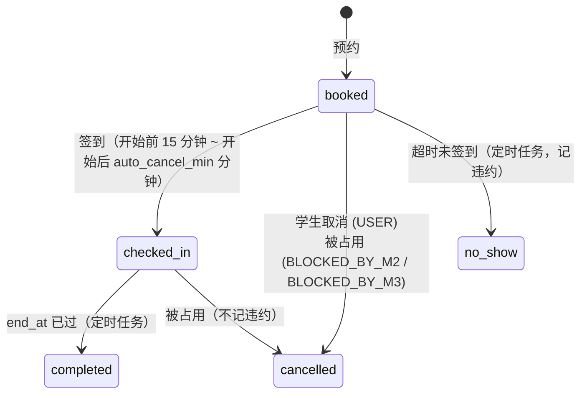

# M1 自习座位预约 设计

| 项目 | 内容 |
|---|---|
| 服务 | `services/m1-seat`，端口 8001，schema `m1` |
| 负责人 | A：预约核心、主数据、跨模块接口、迁移；B：前端、提醒任务、签到码、运营统计、测试 |
| 需求 | REQ-M1-01 至 REQ-M1-15，INT-01 至 INT-04（见 `docs/requirements.md`） |
| 被依赖 | M2、M3 调用 `/internal/v1/*`，接口变更需对方评审 |

## 1. 职责与边界

M1 管理所有空间主数据（教室、自习室、座位）和座位在每个时段的状态。座位"不可用"有三种来源，全部由 M1 写入：

| 来源 | 存放 | 写入方式 |
|---|---|---|
| `M1_RESERVATION` | `reservations` | 学生预约 |
| `M1_ADMIN` | `seats.status`、`rooms.status` | 管理员停用/启用座位或教室 |
| `M2_OCCUPY` | `room_blocks` | M2 调用 `POST /internal/v1/blocks` |
| `M3_MAINTENANCE` | `room_blocks` | M3 调用 `POST /internal/v1/blocks` |

每次状态变化在 `seat_status_logs` 追加一条记录（来源 + 来源单号），用于追溯和验收。M1 不保存用户信息，只保存 `user_id`；用户的院系来自 JWT 的 `dept_id`。

## 2. 数据模型

| 表 | 关键字段 | 约束与说明 |
|---|---|---|
| `rooms` | building, floor, name, type(classroom/library/other), dept_id, capacity, is_study_room, is_whole_bookable, status | (building, name) 唯一；dept_id 为空表示全校开放 |
| `room_open_hours` | room_id, weekday(0=周一), open_hour, close_hour | (room_id, weekday) 唯一；没有记录的日子不开放 |
| `seats` | room_id, code, outlet(none/fixed/rail), status | (room_id, code) 唯一 |
| `reservations` | user_id, seat_id, room_id, start_at, end_at, status, cancel_reason, checked_in_at, reminded_before_at, reminded_late_at | 排除约束 `no_seat_overlap`、`no_user_overlap`，只对 booked/checked_in 生效 |
| `room_blocks` | room_id, source, ref_id, start_at, end_at(可空), reason, created_by, released_at | (source, ref_id) 唯一 |
| `seat_status_logs` | seat_id, at, state(reserved/released/blocked/unblocked), source, ref_id, start_at, end_at | 只追加 |
| `violations` | user_id, reservation_id | reservation_id 唯一：一个预约最多一次违约 |
| `checkin_codes` | room_id, valid_date, code | 主键 (room_id, valid_date) |
| `settings` | key, value | 默认值见 `schemas.SeatSettings` |
| `outbox`、`idempotency_keys` | | 公共库使用 |

## 3. 预约状态机

## 4. 业务规则

| 规则 | 说明 |
|---|---|
| 整点 | 预约以整点小时为单位，接口用 `date + start_hour + end_hour` 表达，服务端用 `timeutil.at_hour()` 转为带时区时间 |
| 时长 | 1 ≤ end_hour − start_hour ≤ `max_hours`（默认 4） |
| 开放时间 | 预约时段必须完全落在该教室当天的开放时间内 |
| 院系 | `rooms.dept_id` 非空时，只有 JWT 中 `dept_id` 相同的用户可见可约 |
| 可约 | 座位与教室均为 enabled；无重叠的有效预约；无重叠且未释放的 `room_blocks`（end_at 为空视为无限期） |
| 提前量 | 只能预约未来的时段；最远可约天数作为参数，待定（见第 10 节） |
| 签到码 | 每间教室每天一个 6 位数字码，首次请求当天的码时生成；二维码内容为 `campus://checkin/{room_id}/{code}` |
| 违约 | 只有 no_show 记违约；用户取消、被占用取消都不记 |

## 5. 接口

记法：`方法 路径 (输入) -> 输出 | 权限`。模型定义见 `app/schemas.py`，完整契约见 `contracts/openapi/m1-seat.json`。

### 5.1 空间与座位

| 接口 | 说明 |
|---|---|
| `GET /api/v1/seat/rooms (building?, type?, is_study_room?, is_whole_bookable?, page, size) -> Page[Room]` 登录即可 | 院系自习室按 dept_id 过滤 |
| `GET /api/v1/seat/rooms/{id} () -> RoomDetail`（含 seats）登录即可 | |
| `POST /api/v1/seat/rooms (RoomCreate) -> Room` \| `seat:room_manage` | |
| `PATCH /api/v1/seat/rooms/{id} (RoomUpdate) -> Room` \| `seat:room_manage` | 含开放时间、启用/停用 |
| `POST /api/v1/seat/rooms/{id}/seats (SeatCreate) -> Seat` \| `seat:room_manage` | |
| `PATCH /api/v1/seat/seats/{id} (SeatUpdate) -> Seat` \| `seat:room_manage` | 插座标记、启用/停用 |
| `GET /api/v1/seat/seats/search (date, start_hour, end_hour, building?, room_id?, outlet?, page, size) -> Page[SeatSearchItem]` 登录即可 | 只返回真正可约的座位 |
| `GET /api/v1/seat/rooms/{id}/availability (date) -> [SeatAvailability]` 登录即可 | 每座位每小时 free/reserved/blocked/closed |
| `GET /api/v1/seat/rooms/{id}/checkin-code () -> CheckinCodeOut` \| `seat:checkin_code` | 教室屏幕调用 |
| `GET /api/v1/seat/seats/{id}/status-history () -> [StatusHistoryItem]` \| `seat:room_manage` 或 `seat:stats` | 写入来源追溯 |

### 5.2 预约与签到

| 接口 | 说明 |
|---|---|
| `POST /api/v1/seat/reservations (seat_id, date, start_hour, end_hour) -> Reservation` \| `seat:reserve` | 错误码见 5.5 |
| `GET /api/v1/seat/reservations/mine (status?, page, size) -> Page[ReservationDetail]` \| `seat:reserve` | 含座位与教室信息 |
| `POST /api/v1/seat/reservations/{id}/cancel () -> Reservation` \| `seat:reserve` | 只能取消自己未开始的预约 |
| `POST /api/v1/seat/reservations/{id}/rebook (date, start_hour, end_hour) -> Reservation` \| `seat:reserve` | 历史复用：同一座位新时段 |
| `POST /api/v1/seat/reservations/{id}/check-in (code) -> Reservation` \| `seat:reserve` | |
| `GET /api/v1/seat/violations/mine (page, size) -> Page[ViolationOut]` \| `seat:reserve` | |

### 5.3 参数与统计

| 接口 | 说明 |
|---|---|
| `GET /api/v1/seat/settings () -> SeatSettings` \| `seat:config` 或 `seat:reserve` | 前端据此限制可选时长 |
| `PUT /api/v1/seat/settings (SeatSettings) -> SeatSettings` \| `seat:config` | |
| `GET /api/v1/seat/stats/usage (date_from, date_to, room_id?) -> UsageStats` \| `seat:stats` | |

### 5.4 跨模块接口（M2、M3 调用）

| 接口 | 调用方 | 说明 |
|---|---|---|
| `GET /internal/v1/rooms/{id} () -> Room` | M2、M3 | 校验教室存在、可整室预约 |
| `POST /internal/v1/blocks (room_id, start_at, end_at?, source, ref_id, reason) + Idempotency-Key -> {block_id, cancelled_reservations}` | M2、M3 | 见第 6 节 |
| `DELETE /internal/v1/blocks/{source}/{ref_id} () -> {released}` | M2、M3 | 幂等；不存在时 released=false |
| `GET /internal/v1/rooms/{id}/reservations (start_at, end_at) -> [Reservation]` | M2、M3 | 时段内的有效预约 |
| `GET /internal/v1/users/{id}/violations (since) -> {user_id, count}` | M2 | 申请门槛 |

### 5.5 错误码

| code | HTTP | 场景 |
|---|---|---|
| `INVALID_DURATION` | 400 | 时长超过 max_hours |
| `OUTSIDE_OPEN_HOURS` | 400 | 不在开放时间内 |
| `RESERVATION_IN_PAST` | 400 | 预约过去的时段 |
| `DEPT_RESTRICTED` | 403 | 院系自习室，非本院系用户 |
| `SEAT_NOT_AVAILABLE` | 409 | 座位已被预约或教室被占用/下架（排除约束 `no_seat_overlap` 触发时也返回此码） |
| `USER_TIME_CONFLICT` | 409 | 本人同一时段已有预约（`no_user_overlap`） |
| `RESERVATION_STATE_CONFLICT` | 409 | 状态不允许该操作（如已开始的预约取消） |
| `CHECKIN_CODE_INVALID` | 400 | 签到码错误 |
| `CHECKIN_WINDOW_CLOSED` | 400 | 不在签到窗口内 |

## 6. 占用与释放（INT-01、INT-02、INT-04）

`POST /internal/v1/blocks` 在一个事务内完成：

1. `run_idempotent` 按 (调用方, Idempotency-Key) 加锁并检查是否已处理，已处理直接返回首次结果。
2. `SELECT ... FROM rooms WHERE id = :room_id FOR UPDATE`：与同一教室的新预约串行化（新预约也先锁教室行）。
3. 插入 `room_blocks`；(source, ref_id) 已存在时返回已有记录。
4. 查出时段内状态为 booked/checked_in 的预约，改为 cancelled，`cancel_reason = BLOCKED_BY_M2 / BLOCKED_BY_M3`，不写 violations。
5. 为每个座位写 `seat_status_logs(state=blocked)`，为被取消的预约写 `released`。
6. outbox：给被取消的学生发 `notification.send`；发 `audit.record`（actor_type=service，actor_id=调用方）；每个被取消的预约发 `m1.reservation.cancelled(reason=BLOCKED)`。
7. 返回 `{block_id, cancelled_reservations}`。

`DELETE /internal/v1/blocks/{source}/{ref_id}`：设置 `released_at`，为每个座位写 `unblocked`，写审计。已释放或不存在时返回 `released=false`，不报错。

搜索、可用性、新预约都要排除"未释放且与时段重叠"的 block（`end_at IS NULL` 视为无限期）。

## 7. 定时任务

任务在 `app/worker.py` 中以 `worker.scan(jobs.<函数>, every=<秒>)` 注册（`campus_common.worker.ServiceWorker`），Celery 任务名为 `m1.<函数名>`。

| 任务（`jobs.py` 函数） | 频率 | 逻辑 | 防重复 | 状态 |
|---|---|---|---|---|
| `send_reminders_before` | 1 分钟 | status=booked、`reminded_before_at IS NULL`、`start_at - remind_before_min <= now < start_at` → 发通知，写 `reminded_before_at` | 字段标记 + SKIP LOCKED | 待实现 |
| `send_reminders_late` | 1 分钟 | status=booked、`reminded_late_at IS NULL`、`start_at + remind_late_min <= now` → 发通知，写 `reminded_late_at` | 同上 | 待实现 |
| `mark_no_shows` | 1 分钟 | 开始后 `auto_cancel_min` 仍未签到 → no_show、释放座位、记违约、通知学生（参考实现，见 `jobs.py`） | 状态条件 + 违约表唯一约束 | 已实现 |
| `complete_finished` | 5 分钟 | status=checked_in、`end_at <= now` → completed | 状态条件 | 待实现 |
| `relay_outbox` | 2 秒 | 公共库（`ServiceWorker` 自动注册） | SKIP LOCKED | 已实现 |

服务重启后错过的提醒会在下一轮补发（条件是"已到时间且未提醒"，不是"恰好在这一分钟"）。如果补发时预约已开始，`send_reminders_before` 应跳过（条件含 `now < start_at`）。

## 8. 并发与一致性

| 场景 | 处理 |
|---|---|
| 两人同时预约同一座位 | 排除约束拒绝后者，捕获 `IntegrityError` 中的约束名转为 409 |
| 预约与占用同时发生 | 两者都先锁 `rooms` 行，串行执行；后执行的一方看到对方的结果 |
| 签到与 no_show 扫描同时发生 | 签到用 `UPDATE ... WHERE id=:id AND status='booked'`；扫描用 SKIP LOCKED，两者只有一个改到 |
| M3 重试下架 | 幂等键 + (source, ref_id) 唯一 |

## 9. 实现顺序

| 顺序 | 内容 | 负责 | 说明 |
|---|---|---|---|
| 1 | `/internal/v1/blocks` 真实实现 + 测试 | A | M2、M3 联调依赖它，最先做 |
| 2 | 教室、座位 CRUD，开放时间 | A | |
| 3 | 搜索与可用性（含 block 过滤） | A | INT-01/02 的可见效果 |
| 4 | 创建、取消、历史、再次预约 | A | |
| 5 | 签到码与签到 | B | |
| 6 | 提醒任务 | B | 参照 `mark_no_shows` |
| 7 | 运营统计、参数修改 | B | |
| 8 | 前端各页面 | B | 随后端接口完成逐步对接 |

## 10. 待讨论

- 最远可提前几天预约？建议 7 天，作为参数 `advance_days_max`。
- 签到窗口开始时间是否也做成参数？
- 是否限制每人每天的预约总时长？任务书只限制单次 4 小时，连续预约两段可以绕过"减少疲劳"的初衷，可以记入伦理与需求讨论。
