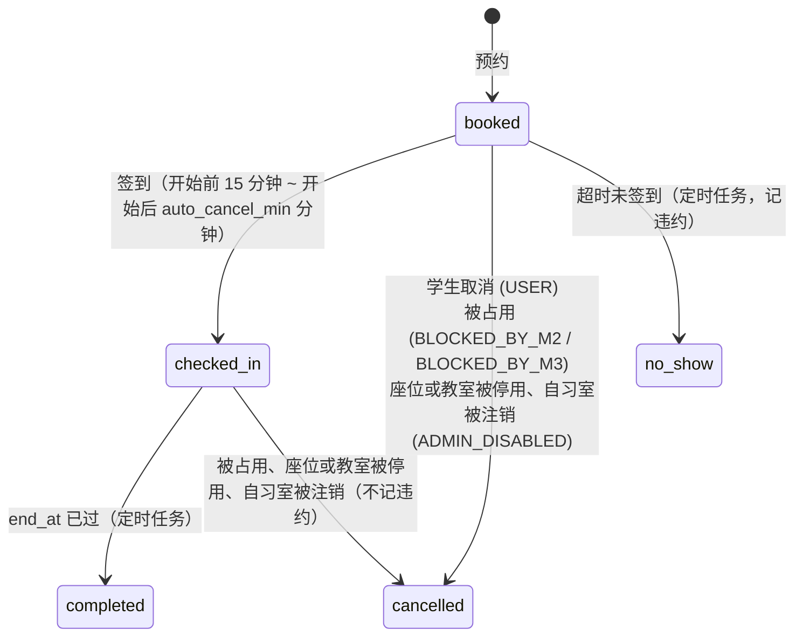

# M1 自习座位预约 设计

| 项目 | 内容 |
|---|---|
| 服务 | `services/m1-seat`，端口 8001，schema `m1` |
| 负责人 | `cyuanb`：M1 后端全部（预约核心、主数据、跨模块接口、迁移、签到、提醒任务、运营统计、测试）；M1 页面由前端负责人 C 实现 |
| 需求 | REQ-M1-01 至 REQ-M1-15，INT-01 至 INT-04（见 `docs/requirements.md`） |
| 被依赖 | M2、M3 调用 `/internal/v1/*`，接口变更需对方评审 |

## 1. 职责与边界

M1 管理所有空间主数据（教室、自习室、座位）和座位在每个时段的状态。座位"不可用"有三种来源，全部由 M1 写入：

| 来源 | 存放 | 写入方式 |
|---|---|---|
| `M1_RESERVATION` | `reservations` | 学生预约 |
| `M1_ADMIN` | `seats.status`、`rooms.status`、`rooms.is_study_room` | 管理员停用/启用座位或教室、注销/登记自习室（不可用时取消尚未结束的有效预约） |
| `M2_OCCUPY` | `room_blocks` | M2 调用 `POST /internal/v1/blocks` |
| `M3_MAINTENANCE` | `room_blocks` | M3 调用 `POST /internal/v1/blocks` |

每次状态变化在 `seat_status_logs` 追加一条记录（来源 + 来源单号），用于追溯和验收：创建预约记为 `reserved`；学生取消、未签到、被占用取消和停用取消记为 `released`（`ref_id` 为预约 ID）；管理员停用、M2 占用、M3 维修下架记为 `blocked`；重新启用、M2 释放、M3 恢复记为 `unblocked`。签到只改变预约状态，不写座位可用性日志。M1 不保存用户信息，只保存 `user_id`；用户的院系来自 JWT 的 `dept_id`。

前端页面、登录与权限实现、通知渠道（站内信、邮件）、M2 审批状态机和 M3 工单状态机不属于 M1 后端范围。

## 2. 数据模型

| 表 | 关键字段 | 约束与说明 |
|---|---|---|
| `rooms` | building, floor, name, type(classroom/library/other), dept_id, capacity, is_study_room, is_whole_bookable, status | (building, name) 唯一；dept_id 为空表示全校开放 |
| `room_open_hours` | room_id, weekday(0=周一), open_hour, close_hour | (room_id, weekday) 唯一；没有记录的日子不开放 |
| `seats` | room_id, code, outlet(none/fixed/rail), status | (room_id, code) 唯一 |
| `reservations` | user_id, seat_id, room_id, start_at, end_at, status, cancel_reason, checked_in_at, reminded_before_at, reminded_late_at | 排除约束 `no_seat_overlap`、`no_user_overlap`，只对 booked/checked_in 生效 |
| `room_blocks` | room_id, source, ref_id, start_at, end_at(可空), reason, created_by, released_at | (source, ref_id) 唯一 |
| `seat_status_logs` | seat_id, at, state(reserved/released/blocked/unblocked), source, ref_id, start_at, end_at | 只追加 |
| `violations` | user_id, reservation_id | reservation_id 唯一：一个预约最多一次违约 |
| `checkin_codes` | room_id, valid_date, code | 主键 (room_id, valid_date) |
| `settings` | key, value | 默认值见 `schemas.SeatSettings` |
| `outbox`、`idempotency_keys` | | 公共库使用 |

## 3. 预约状态机

括号内为 `cancel_reason`。除 no_show 外的取消都不记违约；被占用或停用而取消时通知学生，并发 `m1.reservation.cancelled`（reason 分别为 `USER` / `NO_SHOW` / `BLOCKED` / `ADMIN`）。释放座位时写一条 `released` 状态日志，`ref_id` 为预约 ID，来源为 `M1_RESERVATION`（学生取消、未签到、被占用）或 `M1_ADMIN`（停用）。以上由 `app/shared.py` 的 `release_reservation()` 统一完成。

## 4. 业务规则

| 规则 | 说明 |
|---|---|
| 整点 | 预约以整点小时为单位，接口用 `date + start_hour + end_hour` 表达，服务端用 `timeutil.at_hour()` 转为带时区时间 |
| 时间表示 | 接口响应、消息和通知参数中的时间一律带 `+08:00`（数据库会话时区为业务时区，见 `campus_common.db`）；从时间取日期、整点用 `timeutil.to_biz()` |
| 时长 | 1 ≤ end_hour − start_hour ≤ `max_hours`（默认 4）；结束不晚于开始由请求模型拒绝（422） |
| 开放时间 | 预约时段必须完全落在该教室当天的开放时间内（`open_hour <= start_hour` 且 `end_hour <= close_hour`） |
| 院系 | `rooms.dept_id` 非空时，只有 JWT 中 `dept_id` 相同的用户可约；管理员（`seat:room_manage`）可以查看所有教室，但预约与搜索同样受院系限制 |
| 可约 | 座位与教室均为 enabled 且是自习室；院系允许；在开放时间内；无重叠的有效预约；无重叠且未释放的 `room_blocks`（end_at 为空视为无限期）。规则定义在 `app/shared.py`（`seat_rules()`、`overlaps()`），搜索、按小时可用性、创建预约共用 |
| 提前量 | 只能预约尚未开始的时段（开始时刻已到即不可约）；不限制最远可约天数（ADR-012）。搜索与创建预约共用 `check_slot()`，时段已开始或超过 `max_hours` 时返回同样的错误码 |
| 签到码 | 每间教室每天（业务日期）一个 6 位数字码，首次请求当天的码时生成；二维码内容为 `campus://checkin/{room_id}/{code}`。签到时校验签到时刻所在业务日期的码，即屏幕当时显示的码 |
| 停用与注销 | 座位或教室停用、自习室注销（`is_study_room` 由 true 改为 false）后不能再被使用：不出现在搜索结果中、不能预约；该座位（或该教室全部座位）上尚未结束（`end_at` 晚于停用时刻）的有效预约自动取消，`cancel_reason = ADMIN_DISABLED`，不记违约，通知学生（模板 `seat.reservation_cancelled_by_admin`，参数 `cause` 说明实际原因：`seat_disabled` 座位停用、`room_disabled` 自习室停用、`room_deregistered` 自习室注销；停用与注销同时发生时按停用）。重新启用不恢复已取消的预约。任务书未规定这一点，由项目 owner 确定（ADR-012 补充决定） |
| 违约 | 只有 no_show 记违约；用户取消、被占用取消、停用取消都不记 |
| 参数 | `remind_late_min` 必须小于 `auto_cancel_min`，否则未签到提醒永远发不出去，保存时返回 422 |

## 5. 接口

记法：`方法 路径 (输入) -> 输出 | 权限`。PATCH 接口只修改请求中出现的字段；没出现的字段保持不变，出现的字段按类型校验，不可为空的字段传 null 返回 422。模型定义见 `app/schemas.py`，完整契约见 `contracts/openapi/m1-seat.json`。

### 5.1 空间与座位

| 接口 | 说明 |
|---|---|
| `GET /api/v1/seat/rooms (building?, type?, is_study_room?, is_whole_bookable?, page, size) -> Page[Room]` 登录即可 | 院系自习室按 dept_id 过滤 |
| `GET /api/v1/seat/rooms/{id} () -> RoomDetail`（含 seats）登录即可 | |
| `POST /api/v1/seat/rooms (RoomCreate) -> Room` \| `seat:room_manage` | |
| `PATCH /api/v1/seat/rooms/{id} (RoomUpdate) -> Room` \| `seat:room_manage` | 含开放时间、启用/停用、是否自习室；停用或注销自习室时取消该教室尚未结束的有效预约 |
| `POST /api/v1/seat/rooms/{id}/seats (SeatCreate) -> Seat` \| `seat:room_manage` | |
| `PATCH /api/v1/seat/seats/{id} (SeatUpdate) -> Seat` \| `seat:room_manage` | 插座标记、启用/停用；停用时取消该座位尚未结束的有效预约 |
| `GET /api/v1/seat/seats/search (date, start_hour, end_hour, building?, room_id?, outlet?, page, size) -> Page[SeatSearchItem]` 登录即可 | 只返回当前用户真正可约的座位；时段已开始、超过 `max_hours` 时返回与创建预约相同的错误码 |
| `GET /api/v1/seat/rooms/{id}/availability (date) -> [SeatAvailability]` 登录即可 | 每座位每小时 free/reserved/blocked/closed |
| `GET /api/v1/seat/rooms/{id}/checkin-code () -> CheckinCodeOut` \| `seat:checkin_code` | 教室屏幕调用 |
| `GET /api/v1/seat/seats/{id}/status-history () -> [StatusHistoryItem]` \| `seat:room_manage` 或 `seat:stats` | 写入来源追溯 |

### 5.2 预约与签到

| 接口 | 说明 |
|---|---|
| `POST /api/v1/seat/reservations (seat_id, date, start_hour, end_hour) -> Reservation` \| `seat:reserve` | 错误码见 5.5 |
| `GET /api/v1/seat/reservations/mine (status?, page, size) -> Page[ReservationDetail]` \| `seat:reserve` | 含座位与教室信息 |
| `POST /api/v1/seat/reservations/{id}/cancel () -> Reservation` \| `seat:reserve` | 只能取消自己未开始的预约 |
| `POST /api/v1/seat/reservations/{id}/rebook (date, start_hour, end_hour) -> Reservation` \| `seat:reserve` | 历史复用：同一座位新时段 |
| `POST /api/v1/seat/reservations/{id}/check-in (code) -> Reservation` \| `seat:reserve` | |
| `GET /api/v1/seat/violations/mine (page, size) -> Page[ViolationOut]` \| `seat:reserve` | |

### 5.3 参数与统计

| 接口 | 说明 |
|---|---|
| `GET /api/v1/seat/settings () -> SeatSettings` \| `seat:config` 或 `seat:reserve` | 前端据此限制可选时长 |
| `PUT /api/v1/seat/settings (SeatSettings) -> SeatSettings` \| `seat:config` | |
| `GET /api/v1/seat/stats/usage (date_from, date_to, room_id?) -> UsageStats` \| `seat:stats` | |

### 5.4 跨模块接口（M2、M3 调用）

| 接口 | 调用方 | 说明 |
|---|---|---|
| `GET /internal/v1/rooms/{id} () -> Room` | M2、M3 | 校验教室存在、可整室预约 |
| `POST /internal/v1/blocks (room_id, start_at, end_at?, source, ref_id, reason) + Idempotency-Key -> {block_id, cancelled_reservations}` | M2、M3 | 见第 6 节 |
| `DELETE /internal/v1/blocks/{source}/{ref_id} () -> {released}` | M2、M3 | 幂等；不存在或已释放时 released=false |
| `GET /internal/v1/rooms/{id}/reservations (start_at, end_at) -> [Reservation]` | M2、M3 | 时段内的有效预约；end_at 不晚于 start_at 时 422 |
| `GET /internal/v1/users/{id}/violations (since) -> {user_id, count}` | M2 | 申请门槛；统计 `created_at >= since` |

### 5.5 错误码

每条规则只有一个错误码；各路由的 docstring（即 OpenAPI 描述）列出该接口可能返回的错误码。登录与权限错误（401 `UNAUTHENTICATED` / `TOKEN_*`、403 `FORBIDDEN`，服务间调用 401 `SERVICE_UNAUTHENTICATED`、403 `SERVICE_FORBIDDEN`）由公共库返回，不在此列出。

| code | HTTP | 接口 | 场景 |
|---|---|---|---|
| `VALIDATION_ERROR` | 422 | 全部 | 请求不合法，包括结束不晚于开始（预约、复订、搜索的整点时段；内部接口的 start_at/end_at；占用的 end_at）、`remind_late_min >= auto_cancel_min`、PATCH 教室或座位时给不可为空的字段传 null（只有 `dept_id` 可以传 null，表示改为全校开放） |
| `NOT_FOUND` | 404 | 全部 | 教室、座位、预约不存在，或对当前用户不可见（他人的预约、其他院系或已停用的教室） |
| `INVALID_DURATION` | 400 | 预约、复订、搜索 | 时长超过 max_hours |
| `RESERVATION_IN_PAST` | 400 | 预约、复订、搜索 | 时段已开始（开始时刻已到） |
| `OUTSIDE_OPEN_HOURS` | 400 | 预约、复订 | 不在开放时间内（搜索中直接不返回该座位） |
| `DEPT_RESTRICTED` | 403 | 预约、复订 | 院系自习室，非本院系用户 |
| `SEAT_NOT_AVAILABLE` | 409 | 预约、复订 | 座位或教室停用、座位已被预约、教室被占用/下架（排除约束 `no_seat_overlap` 触发时也返回此码） |
| `USER_TIME_CONFLICT` | 409 | 预约、复订 | 本人同一时段已有预约（`no_user_overlap`） |
| `RESERVATION_STATE_CONFLICT` | 409 | 取消、签到 | 状态不允许该操作（如取消已开始的预约、签到已被取消的预约） |
| `CHECKIN_WINDOW_CLOSED` | 400 | 签到 | 不在签到窗口内 |
| `CHECKIN_CODE_INVALID` | 400 | 签到 | 签到码不是教室屏幕当前显示的码 |
| `INVALID_OPEN_HOURS` | 400 | 登记、修改教室 | 同一星期配置了多条开放时间 |
| `ROOM_ALREADY_EXISTS` | 409 | 登记、修改教室 | 同一楼宇中教室重名（`uq_rooms_building_name`） |
| `SEAT_ALREADY_EXISTS` | 409 | 登记座位 | 同一教室中座位编号重复（`uq_seats_room_id_code`） |
| `INVALID_DATE_RANGE` | 400 | 运营统计 | `date_to` 早于 `date_from` |
| `BLOCK_SOURCE_FORBIDDEN` | 403 | 占用、释放 | source 与调用方不符（M2 只能用 `M2_OCCUPY`，M3 只能用 `M3_MAINTENANCE`） |
| `IDEMPOTENCY_KEY_REUSED` | 409 | 占用 | 同一幂等键对应了不同的请求内容（同一幂等键、同样的请求则重放首次结果） |
| `BLOCK_REFERENCE_CONFLICT` | 409 | 占用 | 换了幂等键，同一 (source, ref_id) 却是不同的占用请求 |
| `BLOCK_ALREADY_RELEASED` | 409 | 占用 | 换了幂等键，而该 (source, ref_id) 的占用已释放。M2、M3 的幂等键按单号固定，正常重试不会遇到它，同键重发得到的是首次结果（见第 6 节） |

## 6. 占用与释放（INT-01、INT-02、INT-04）

`POST /internal/v1/blocks` 在一个事务内完成：

1. `run_idempotent` 按 (调用方, Idempotency-Key) 加锁并检查是否已处理，已处理直接返回首次结果。
2. `SELECT ... FROM rooms WHERE id = :room_id FOR UPDATE`：与同一教室的新预约、停用串行化（它们也先锁教室行）。
3. `INSERT INTO room_blocks ... ON CONFLICT (source, ref_id) DO NOTHING`：(source, ref_id) 唯一，一个单号只对应一次占用生命周期。只有换了幂等键的请求才会走到这里（同一幂等键在第 1 步已被重放或拒绝）。已存在时不再取消预约：已释放返回 409 `BLOCK_ALREADY_RELEASED`；请求内容（教室、起止、原因）不同返回 409 `BLOCK_REFERENCE_CONFLICT`；相同则返回已有的 `block_id`，`cancelled_reservations` 为空（被取消的预约在首次调用的返回值里）。
4. 查出时段内状态为 booked/checked_in 的预约，改为 cancelled，`cancel_reason = BLOCKED_BY_M2 / BLOCKED_BY_M3`，不写 violations。
5. 为每个座位写 `seat_status_logs(state=blocked)`，为被取消的预约写 `released`。
6. outbox：给被取消的学生发 `notification.send`；发 `audit.record`（actor_type=service，actor_id=调用方）；每个被取消的预约发 `m1.reservation.cancelled(reason=BLOCKED)`。
7. 返回 `{block_id, cancelled_reservations}`。

`DELETE /internal/v1/blocks/{source}/{ref_id}`：设置 `released_at`，为每个座位写 `unblocked`，写审计。已释放或不存在时返回 `released=false`，不报错。释放后同一单号不能再产生新的占用：M2 重新审批、M3 重新维修时使用新的申请或工单号。

对 M2、M3 的实际调用方式（幂等键按单号固定）而言，释放后再次 POST 同一单号的结果是：

| 请求 | 结果 |
|---|---|
| 同一幂等键、同样的请求 | 200，重放首次结果（其中的 `cancelled_reservations` 是首次取消的预约），不会重新占用 |
| 同一幂等键、不同的请求 | 409 `IDEMPOTENCY_KEY_REUSED` |
| 新的幂等键、同一单号 | 409 `BLOCK_ALREADY_RELEASED` |

搜索、可用性、新预约都要排除"未释放且与时段重叠"的 block（`end_at IS NULL` 视为无限期）。

## 7. 定时任务

任务在 `app/worker.py` 中以 `worker.scan(jobs.<函数>, every=<秒>)` 注册（`campus_common.worker.ServiceWorker`），Celery 任务名为 `m1.<函数名>`。

| 任务（`jobs.py` 函数） | 频率 | 逻辑 | 防重复 | 状态 |
|---|---|---|---|---|
| `send_reminders_before` | 1 分钟 | status=booked、`reminded_before_at IS NULL`、`start_at - remind_before_min <= now < start_at` → 发通知，写 `reminded_before_at` | 字段标记 + SKIP LOCKED | 已实现 |
| `send_reminders_late` | 1 分钟 | status=booked、`reminded_late_at IS NULL`、`start_at + remind_late_min <= now < start_at + auto_cancel_min` → 发通知，写 `reminded_late_at` | 同上 | 已实现 |
| `mark_no_shows` | 1 分钟 | 开始后 `auto_cancel_min` 仍未签到 → no_show、释放座位、记违约、通知学生（参考实现，见 `jobs.py`） | 状态条件 + 违约表唯一约束 | 已实现 |
| `complete_finished` | 5 分钟 | status=checked_in、`end_at <= now` → completed | 状态条件 | 已实现 |
| `relay_outbox` | 2 秒 | 公共库（`ServiceWorker` 自动注册） | SKIP LOCKED | 已实现 |

服务重启后错过的提醒会在下一轮补发（条件是"已到时间且未提醒"，不是"恰好在这一分钟"）。如果补发时预约已开始，`send_reminders_before` 应跳过（条件含 `now < start_at`）。

## 8. 并发与一致性

| 场景 | 处理 |
|---|---|
| 两人同时预约同一座位 | 排除约束拒绝后者，`campus_common.db.constraint_errors()` 按约束名转为 409 |
| 预约、占用、停用同时发生 | 都先锁 `rooms` 行，串行执行；后执行的一方看到对方的结果（预约在锁住教室之后才读取座位与教室状态） |
| 签到与 no_show 扫描同时发生 | 签到先 `SELECT ... FOR UPDATE` 锁住预约再检查状态；扫描用 SKIP LOCKED，两者只有一个改到 |
| M3 重试下架 | 同一幂等键：`run_idempotent`；换了幂等键：(source, ref_id) 唯一约束 + `ON CONFLICT DO NOTHING` |
| 多块屏幕同时首次取当天签到码 | 主键 (room_id, valid_date) + `ON CONFLICT DO NOTHING`，再读出已有的码 |

## 9. 实现状态

| 内容 | 状态 | 说明 |
|---|---|---|
| `/internal/v1/blocks`、释放接口和内部查询 | 已完成 | M2、M3 的 M1 侧接口与单元测试已完成，真实链路待联调 |
| 教室、座位和开放时间管理 | 已完成 | |
| 搜索与可用性（含整室占用过滤） | 已完成 | |
| 创建、取消、历史、再次预约 | 已完成 | |
| 签到码与签到 | 已完成 | |
| 提醒、未签到取消和完成扫描 | 已完成 | |
| 运营统计、参数修改 | 已完成 | |
| 前端各页面 | 不在 M1 后端范围 | 由前端负责人 C 对接 |

## 10. 已确认的 v1 边界

- 不增加最远提前预约天数限制，保持任务书规定的预约范围和现有接口契约。
- 不增加每人每天总预约时长限制。连续预约可能绕过单次 4 小时限制，相关问题记录在伦理讨论中。
- 签到窗口从预约开始前 15 分钟开始，到 `start_at + auto_cancel_min` 之前结束；到达截止时刻后，未签到扫描可以取消预约。
- 座位或教室停用、自习室注销时取消其尚未结束的有效预约（不记违约、通知学生），由项目 owner 确定（任务书只要求管理员维护登记、注销与可用性，未规定已有预约如何处理），见 ADR-012 补充决定。
- 状态日志记录座位可用性变化；签到只改变预约状态，不额外写座位可用性日志。
- 利用率按已签到预约小时数除以有效开放座位小时数计算；有效开放座位小时数按开放时间和当前启用座位计算，并扣除整室占用时段。模型没有座位启用状态和开放时间的历史序列，历史统计只能按当前配置计算；需要精确还原时再增加对应的时间序列数据。
- 违约率按 `no_show / (no_show + completed)` 计算，分母为 0 时返回 0。
- 运营统计只返回聚合结果，不返回学生个人自习轨迹。

## 11. 伦理关注

- 每日签到码可能被暴力尝试或转交他人，需要后续评估错误次数限制和异常签到处理（REQ-M1-18，延后）。
- 连续预约多个相邻时段可能绕过单次四小时限制，需要后续评估每日总时长或高峰配额（REQ-M1-16，延后）。
- 自动取消和违约记录可能因签到设备或网络问题误判，需要保留通知、状态记录和后续申诉机制（REQ-M1-19，延后；`docs/ethics-log.md` E-01）。
- 座位或教室停用会被动取消学生的预约：通知中说明原因，不记违约。

决策背景与取舍见 [ADR-012](../adr/012-M1后端业务边界与统计口径.md)。
