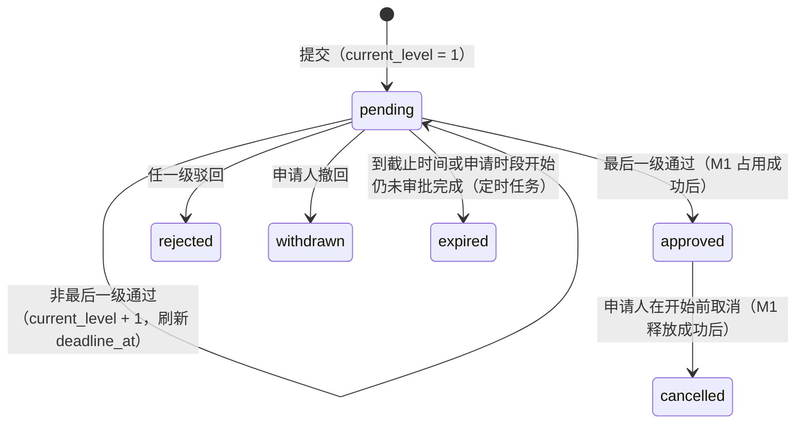

# M2 整教室预约与审批 设计

| 项目 | 内容 |
|---|---|
| 服务 | `services/m2-room`，端口 8002，schema `m2` |
| 负责人 | `twllif`：资格门槛、申请提交、审批状态机、超时撤销、审批流与参数配置 |
| 需求 | REQ-M2-01 至 REQ-M2-09，INT-02、INT-05、INT-07 |
| 依赖 | M1（教室信息与开放时间、占用/释放、违约次数、受影响预约数）；common（经消息投递通知，按权限码与院系解析收件人） |

## 1. 职责与边界

M2 管理"借用整间教室"的申请和审批。教室信息属于 M1，M2 保存 `room_id` 和提交时的教室名称快照（用于通知）；教室在某时段被占用这件事由 M1 记录，M2 只在最终审批通过时请求 M1 占用、在取消或残留时请求释放。M2 不调用 common：申请人、审批人的显示信息取自登录凭证，通知经 outbox 发出，收件人由 common 解析。

## 2. 数据模型

| 表 | 关键字段 | 说明 |
|---|---|---|
| `approval_flows` | name(≤50), room_type?, dept_scoped?, priority, levels(JSONB) | levels：`[{level, approver_perm, scope: dept/school, timeout_hours}]`，级别从 1 连续；按 room_type 与是否院系教室匹配，多条匹配取 priority 最大 |
| `applications` | applicant_id, applicant_username, applicant_name, applicant_dept_id, room_id, room_name, start_at, end_at, purpose, attendees, status, flow_snapshot, current_level, deadline_at, m1_block_id, occupy_requested_at, version | 申请人与教室名称是提交时的快照；flow_snapshot 是提交时的审批流副本；occupy_requested_at 是最近一次请求 M1 占用的时间（非空表示 M1 可能持有本申请的占用）；version 用于乐观锁；排除约束 `no_application_overlap` 保证同一教室 pending/approved 申请时段不重叠 |
| `approval_records` | application_id, level, approver_id?, approver_username?, approver_name?, approver_dept_id?, action, comment, at | 每次动作一条，操作人信息取自当时的登录凭证；系统动作（超时）操作人为空 |
| `settings` | key, value | 默认值见 `schemas.RoomSettings` |
| `outbox` | | |

## 3. 申请状态机

所有迁移都走 `room_service.transition()`：检查当前状态、按当前级别写 `approval_records`、状态变化时发 `m2.application.status_changed`；定时任务共用它。

"审批驳回或超时撤销后回滚"的理解：教室只在最终通过时才占用，所以 pending 阶段的驳回与超时没有占用需要回滚；已通过后的取消会释放占用。理由见 [ADR-005](../adr/005-M2占用时机.md)。唯一的例外是最终审批请求 M1 后失败（例如 M1 超时但其实已占用）、申请之后未通过就结束，见 §7 `release_leftover_blocks`。

## 4. 业务规则

| 规则 | 说明 |
|---|---|
| 资格 | 拥有 `room:apply`；近 `violation_window_days` 天在 M1 的违约次数 < `max_violations`；不满足时原因写明实际次数与上限，如"近 30 天违约 3 次，违约达到 3 次不能申请" |
| 可申请的教室 | M1 返回 enabled 且 `is_whole_bookable = true`；院系教室（`dept_id` 非空）只接受该院系的申请人（与 M1 院系教室的可见范围一致） |
| 人数 | `attendees` ≤ 教室容量（等于容量允许） |
| 提前天数 | 开始时间晚于现在（等于现在拒绝），且开始日期（业务时区自然日）− 今天（业务时区）在 `[advance_days_min, advance_days_max]` 内；与前端日期选择一致 |
| 开放时间 | 时段完全落在教室在开始日期那个星期几的开放时间内（`open_hour:00 ≤ 开始`，`结束 ≤ close_hour:00`，可以正好从开门开始、到关门结束）；当天没有开放时间记录即不开放；因此也不能跨天（最晚到当天 24:00） |
| 用途 | 去掉首尾空白后 2–500 字 |
| 申请冲突 | 同一教室时段重叠的 pending/approved 申请不能同时存在（相邻时段允许）：预检查给出友好错误，并发提交由排除约束保证 |
| 审批流 | 至少一条；名称去掉首尾空白后 1–50 字且不重复；每级权限码由范围决定：`dept` → `room:approve`，`school` → `room:approve_school`，不一致返回 422 |
| 申请人院系 | 匹配到的审批流含院系级而申请人不属于任何院系时拒绝提交（否则没有人能审批） |
| 审批范围 | 当前级 `scope=dept`：审批人有 `room:approve` 且 `dept_id` 等于申请人 `applicant_dept_id`；`scope=school`：任何有 `room:approve_school` 的人 |
| 审批人限制 | 申请人不能审批自己的申请；同一人不能审批同一申请的两个级别 |
| 截止时间 | 进入某一级时 `deadline_at = now + timeout_hours`；`deadline_at` 或 `start_at` 已到（含该时刻）时不能再通过或驳回，等待定时任务撤销 |
| 取消 | 只有已通过且开始时间未到（`now < start_at`）的申请可以取消 |
| 可见范围 | 申请人本人、在申请上有记录的人、能审批快照中任一级的人可以查看详情；其他人得到 404。看得到但无权执行操作时 403 |

"谁此刻能处理申请的当前级别"只在 `room_service.turn_rules()` 定义一次（SQL 条件）：审批时逐条检查给出错误码，待办列表用同一组条件在数据库里筛选并分页。

## 5. 接口

记法：`方法 路径 (输入) -> 输出 | 权限`。完整契约见 `contracts/openapi/m2-room.json`，各接口的错误码写在路由 docstring 中。

| 接口 | 说明 |
|---|---|
| `GET /api/v1/room/eligibility () -> {eligible, reasons}` \| `room:apply` | 调用 M1 查违约次数 |
| `POST /api/v1/room/applications (room_id, start_at, end_at, purpose, attendees) -> Application` \| `room:apply` | 匹配审批流并快照，进入第 1 级，通知第 1 级审批人 |
| `GET /api/v1/room/applications/mine (status?, page, size) -> Page[Application]` \| `room:apply` | 按提交时间倒序 |
| `GET /api/v1/room/applications/{id} () -> Application` \| `room:apply` / `room:approve` / `room:approve_school` | 可见范围见 §4 |
| `POST /api/v1/room/applications/{id}/withdraw () -> Application` \| `room:apply` | pending → withdrawn；approved 且未开始 → 先释放再 cancelled |
| `GET /api/v1/room/approvals/todo (page, size) -> Page[ApplicationForApprover]` \| `room:approve` / `room:approve_school` | 只列当前用户此刻能处理的申请，按截止时间排序；`affected_reservations` 逐条并发查询 M1，失败时为 null（不影响列表） |
| `POST /api/v1/room/applications/{id}/approve (comment?) -> Application` \| `room:approve` / `room:approve_school` | |
| `POST /api/v1/room/applications/{id}/reject (comment?) -> Application` \| `room:approve` / `room:approve_school` | |
| `GET/PUT /api/v1/room/flows ([ApprovalFlow])` \| `room:flow_manage` | 整体替换 |
| `GET/PUT /api/v1/room/settings (RoomSettings)` \| `room:flow_manage` | GET 也对 `room:apply` 开放，前端用于提示 |

错误码：

| 码 | 状态 | 场景 |
|---|---|---|
| `NOT_ELIGIBLE` | 403 | 违约次数达到上限，details 为原因列表 |
| `ROOM_NOT_BOOKABLE` | 400 | 教室停用或不允许整教室预约 |
| `DEPT_RESTRICTED` | 403 | 院系教室，申请人不属于该院系 |
| `ATTENDEES_EXCEED_CAPACITY` | 400 | 参加人数超过教室容量 |
| `ADVANCE_DAYS_OUT_OF_RANGE` | 400 | 开始时间不晚于现在，或开始日期不在允许的提前天数内 |
| `OUTSIDE_OPEN_HOURS` | 400 | 时段不在教室当天开放时间内（含跨天） |
| `APPROVAL_FLOW_NOT_FOUND` | 409 | 没有适用于该教室的审批流 |
| `APPLICANT_DEPT_REQUIRED` | 400 | 审批流含院系级而申请人不属于任何院系 |
| `APPLICATION_TIME_CONFLICT` | 409 | 与该教室其他有效申请时段重叠 |
| `NOT_YOUR_TURN` | 403 | 审批自己的申请、没有当前级别的权限码、院系级而不同院系、已审批过该申请的其他级别 |
| `APPLICATION_EXPIRED` | 409 | 当前级别截止时间或申请开始时间已到，不能再审批 |
| `APPLICATION_STATE_CONFLICT` | 409 | 状态不允许该操作（含已开始的申请不能取消），或乐观锁冲突 |
| `FORBIDDEN` | 403 | 撤回或取消别人的申请 |
| `DUPLICATE_FLOW_NAME` | 409 | 审批流名称重复 |
| `NOT_FOUND` | 404 | 申请不存在或看不到；教室不存在（来自 M1） |
| `UPSTREAM_UNAVAILABLE` / `UPSTREAM_ERROR` | 502 | M1 不可用或拒绝调用；M1 的业务错误（如占用冲突 409）原样返回 |

## 6. 对外调用与通知

`app/clients.py` 只写业务语义，通信由公共库客户端 `campus_common.clients.m1.M1Client` 完成（服务身份、超时、错误转换、桩数据）；幂等键由 `clients.idempotency_key()` 生成。测试中用 `campus_common.testing.record_service_calls()` 记录或模拟远端调用。

| 函数 | 远端接口 | 幂等键 |
|---|---|---|
| `get_room(room_id)` | `GET /internal/v1/rooms/{id}`（含开放时间） | — |
| `occupy_room(application)` | `POST /internal/v1/blocks`（source=M2_OCCUPY，ref_id=申请 ID，reason=申请用途，超过 200 字截断） | `m2-app-{id}-occupy` |
| `release_room(app_id)` | `DELETE /internal/v1/blocks/M2_OCCUPY/{id}` | 天然幂等 |
| `count_affected_reservations(room_id, start_at, end_at)` | `GET /internal/v1/rooms/{id}/reservations` | — |
| `violation_count(user_id, since)` | `GET /internal/v1/users/{id}/violations` | — |

占用请求只取申请上不可变的字段，同一申请的每次请求完全相同，M1 按幂等键返回首次结果；M1 因此在取消预约的通知里写"整教室借用：<用途>"。

通知全部经 outbox（`NotificationSend`），模板登记在 common 的 `app/templates.py`。每条都带 `application_id`、`room`（"楼宇 名称"）、`purpose`、`start_at`、`end_at`（+08:00）。"审批人"按该级权限码寻址（`perm`），院系级另带 `dept_id` = 申请人院系，由 common 解析收件人。

| 时机 | 模板 | 收件人 | 其他参数 |
|---|---|---|---|
| 提交 | `room.application_submitted` | 第 1 级审批人 | applicant, attendees, level=1 |
| 非最后一级通过 | `room.level_approved` | 申请人 | level（通过的级别）, next_level |
| 非最后一级通过 | `room.approval_requested` | 下一级审批人 | applicant, attendees, level（等待的级别） |
| 最后一级通过 | `room.application_approved` | 申请人 | — |
| 驳回 | `room.application_rejected` | 申请人 | level, comment |
| 撤回 | `room.application_withdrawn` | 当前级别审批人 | applicant, level |
| 取消 | `room.application_cancelled` | 审批通过过该申请的人（user_ids） | applicant |
| 超时撤销 | `room.application_expired` | 申请人 | level、cause（`deadline` 超过审批时限 / `started` 申请时段已开始） |

### 最终审批通过的步骤

1. 加载申请（看不到则 404），按 `turn_rules()` 检查：pending、截止与开始时间未到、不是申请人、符合当前级别的权限码与范围、没有审批过其他级别。
2. 记下 `occupy_requested_at = now` 并提交。并发的另一次最终审批或撤销在这一步因 `version` 冲突返回 409，后到的一方不会调用 M1。
3. 调用 `occupy_room`。失败 → 申请仍是 pending（审批人可重试），错误原样返回：M1 不可达或拒绝调用 502，M1 的业务错误（如教室已被占用 409）原样返回。
4. 在一个事务里：status=approved、写 `approval_records`、保存 `m1_block_id`、outbox 通知申请人、发 `m2.application.status_changed`。`version` 冲突时返回 409 `APPLICATION_STATE_CONFLICT`，不在请求里补偿：若对方是另一次成功的最终审批，占用属于它，不能释放；若对方使申请结束（驳回、撤回、超时），由 `release_leftover_blocks` 释放。补偿因此不会掩盖原始错误，也不会误释放别人的占用。

### 取消已通过的申请

先 `release_room`，成功后在一个事务里改为 cancelled、清空 `occupy_requested_at`、通知审批过的人。M1 失败时申请保持 approved（502，可重试）。本地提交失败时教室已释放、申请仍是 approved，重试会再次释放（M1 返回 `released=false`）后照常完成。

## 7. 定时任务

| 任务 | 频率 | 逻辑 |
|---|---|---|
| `expire_overdue` | 1 分钟 | `status='pending' AND (deadline_at <= now OR start_at <= now)`，SKIP LOCKED 抢行 → expired，写审批记录（系统动作，注明超时或已开始），通知申请人；与审批人并发时由 `version` 保证只有一方生效 |
| `release_leftover_blocks` | 1 分钟 | `status IN ('rejected','withdrawn','expired') AND occupy_requested_at <= now - 1 分钟`，SKIP LOCKED 抢行（每批 20 条），调用 M1 释放（幂等）后清空 `occupy_requested_at`；M1 失败的留到下一轮。1 分钟的等待大于 M1 客户端超时，在途的占用请求结束后才释放 |
| `relay_outbox` | 2 秒 | 公共库 |

## 8. 实现顺序

| 顺序 | 内容 | 负责 | 状态 |
|---|---|---|---|
| 1 | 审批流匹配与快照、提交申请（含冲突检查） | `twllif` | 已实现 |
| 2 | 资格门槛、参数读写 | `twllif` | 已实现 |
| 3 | 审批通过/驳回状态机 | `twllif` | 已实现 |
| 4 | 超时撤销与残留占用释放 | `twllif` | 已实现 |
| 5 | 撤回与取消、通知 | `twllif` | 已实现 |
| 6 | 审批流配置接口 | `twllif` | 已实现 |
| 7 | 与 M1 联调（`STUB_CLIENTS=false`），去掉集成测试的 xfail | `twllif` | 待联调 |

## 9. 待讨论

- 审批人在审批前能否看到受影响学生名单？涉及隐私，目前只给人数（见伦理记录）。
- 已通过的申请临近开始时还能否取消？目前开始前任何时候都可以取消。
- 受影响预约数目前每条待办查询一次 M1（并发）；若待办量大，可请 M1 提供按多个时段批量查询的接口。
