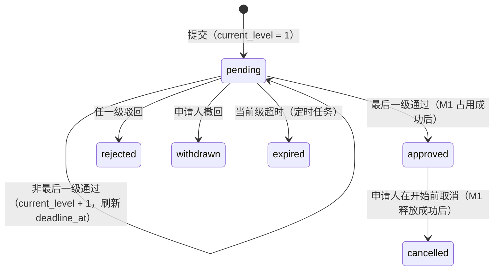

# M2 整教室预约与审批 设计

| 项目 | 内容 |
|---|---|
| 服务 | `services/m2-room`，端口 8002，schema `m2` |
| 负责人 | C：申请提交、审批状态机、超时撤销；D：资格门槛、审批流与参数配置（D 同时负责 common 的 RBAC） |
| 需求 | REQ-M2-01 至 REQ-M2-09，INT-02、INT-05 |
| 依赖 | M1（教室信息、占用/释放、违约次数、受影响预约数）；common（按权限查审批人） |

## 1. 职责与边界

M2 管理"借用整间教室"的申请和审批。教室信息属于 M1，M2 只保存 `room_id`；教室在某时段被占用这件事也由 M1 记录，M2 只在审批通过时请求 M1 占用、在取消时请求释放。

## 2. 数据模型

| 表 | 关键字段 | 说明 |
|---|---|---|
| `approval_flows` | name, room_type?, dept_scoped?, priority, levels(JSONB) | levels：`[{level, approver_perm, scope: dept/school, timeout_hours}]`；按 room_type 与是否院系教室匹配，多条匹配取 priority 最大 |
| `applications` | applicant_id, applicant_dept_id, room_id, start_at, end_at, purpose, attendees, status, flow_snapshot, current_level, deadline_at, m1_block_id, version | flow_snapshot 是提交时的审批流副本；version 用于乐观锁 |
| `approval_records` | application_id, level, approver_id?, action, comment, at | 每次审批动作一条；系统动作 approver_id 为空 |
| `settings` | key, value | 默认值见 `schemas.RoomSettings` |
| `outbox` | | |

## 3. 申请状态机

"审批驳回或超时撤销后回滚"的理解：教室只在最终通过时才占用，所以 pending 阶段的驳回与超时没有占用需要回滚；已通过后的取消会释放占用。理由见 [ADR-005](../adr/005-M2占用时机.md)。

## 4. 业务规则

| 规则 | 说明 |
|---|---|
| 资格 | 拥有 `room:apply`；近 `violation_window_days` 天在 M1 的违约次数 < `max_violations` |
| 可申请的教室 | M1 返回 `is_whole_bookable = true` 且 enabled |
| 时间 | 带时区；开始时间距今 `advance_days_min` 至 `advance_days_max` 天；结束晚于开始 |
| 申请冲突 | 同一教室时段重叠的 pending/approved 申请不能同时存在（后提交的返回 409；可考虑排除约束） |
| 审批范围 | 当前级 `scope=dept`：审批人 `dept_id` 必须等于申请人 `applicant_dept_id`；`scope=school`：任何拥有 `approver_perm` 的人 |
| 审批人不能审批自己的申请 | |
| 截止时间 | 进入某一级时 `deadline_at = now + timeout_hours` |

## 5. 接口

记法：`方法 路径 (输入) -> 输出 | 权限`。完整契约见 `contracts/openapi/m2-room.json`。

| 接口 | 说明 |
|---|---|
| `GET /api/v1/room/eligibility () -> {eligible, reasons}` \| `room:apply` | 调用 M1 查违约次数 |
| `POST /api/v1/room/applications (room_id, start_at, end_at, purpose, attendees) -> Application` \| `room:apply` | 匹配审批流并快照，进入第 1 级，通知第 1 级审批人 |
| `GET /api/v1/room/applications/mine (status?, page, size) -> Page[Application]` \| `room:apply` | |
| `GET /api/v1/room/applications/{id} () -> Application` \| `room:apply` 或 `room:approve` | 申请人本人或有权审批的人 |
| `POST /api/v1/room/applications/{id}/withdraw () -> Application` \| `room:apply` | pending → withdrawn；approved → cancelled 并释放 |
| `GET /api/v1/room/approvals/todo (page, size) -> Page[ApplicationForApprover]` \| `room:approve` | 含 `affected_reservations` |
| `POST /api/v1/room/applications/{id}/approve (comment?) -> Application` \| `room:approve` | |
| `POST /api/v1/room/applications/{id}/reject (comment?) -> Application` \| `room:approve` | |
| `GET/PUT /api/v1/room/flows ([ApprovalFlow])` \| `room:flow_manage` | |
| `GET/PUT /api/v1/room/settings (RoomSettings)` \| `room:flow_manage` | GET 也对 `room:apply` 开放，前端用于提示 |

错误码：`NOT_ELIGIBLE`(403)、`ROOM_NOT_BOOKABLE`(400)、`ADVANCE_DAYS_OUT_OF_RANGE`(400)、`APPLICATION_TIME_CONFLICT`(409)、`NOT_YOUR_TURN`(403，不是当前级审批人)、`APPLICATION_STATE_CONFLICT`(409，状态已变化或乐观锁冲突)、`UPSTREAM_UNAVAILABLE`(502，M1 不可用)。

## 6. 对外调用（`app/clients.py`）

`app/clients.py` 只写业务语义，通信由公共库客户端 `campus_common.clients.m1.M1Client` / `clients.common.CommonClient` 完成（服务身份、超时、错误转换、桩数据）；幂等键由 `clients.idempotency_key()` 生成。客户端与 M1、common 契约的一致性由公共库的契约测试保证。测试中用 `campus_common.testing.record_service_calls()` 记录或模拟远端调用。

| 函数 | 远端接口 | 幂等键 |
|---|---|---|
| `get_room(room_id)` | `GET /internal/v1/rooms/{id}` | — |
| `occupy_room(app_id, room_id, start_at, end_at, reason)` | `POST /internal/v1/blocks`（source=M2_OCCUPY） | `m2-app-{id}-occupy` |
| `release_room(app_id)` | `DELETE /internal/v1/blocks/M2_OCCUPY/{id}` | 天然幂等 |
| `count_affected_reservations(room_id, start_at, end_at)` | `GET /internal/v1/rooms/{id}/reservations` | — |
| `violation_count(user_id, since)` | `GET /internal/v1/users/{id}/violations` | — |
| `users_with_perm(perm, dept_id?)` | common `GET /internal/v1/users` | — |

### 最终审批通过的步骤

1. 加载申请，检查状态为 pending、审批人是当前级合法审批人。
2. 调用 `occupy_room`。失败 → 申请不变（审批人可重试）：M1 不可达或拒绝调用返回 502，M1 的业务错误（如教室已被占用 409）原样返回。
3. 在一个事务里：status=approved、写 `approval_records`、保存 `m1_block_id`、outbox 通知申请人、发 `m2.application.status_changed`。`version` 冲突时回滚本地事务并重新读取申请：若已是 approved（并发的另一次最终审批已成功，占用属于它），不做补偿、返回 409 `APPLICATION_STATE_CONFLICT`；若是其他状态（如同时被超时撤销），调用 `release_room` 撤销刚才的占用。同一申请的占用共用幂等键 `m2-app-{id}-occupy`，因此不能不加判断地释放。

步骤 3 失败后的补偿是这条链路里唯一需要"撤销远端操作"的地方，测试要覆盖：同时被超时撤销（释放）、并发两次最终审批（不释放）。

## 7. 定时任务

| 任务 | 频率 | 逻辑 | 状态 |
|---|---|---|---|
| `expire_overdue` | 1 分钟 | status=pending 且 `deadline_at <= now`，SKIP LOCKED 抢行 → expired，写审批记录（action=expire），通知申请人 | 待实现 |
| `relay_outbox` | 2 秒 | 公共库 | 已实现 |

## 8. 实现顺序

| 顺序 | 内容 | 负责 |
|---|---|---|
| 1 | 审批流匹配与快照、提交申请（含冲突检查） | C |
| 2 | 资格门槛（已部分实现）、参数读写 | D |
| 3 | 审批通过/驳回状态机（先用 `STUB_CLIENTS=true`） | C |
| 4 | 超时撤销任务 | C |
| 5 | 撤回与取消、通知 | C |
| 6 | 审批流配置接口 | D |
| 7 | 与 M1 联调（`STUB_CLIENTS=false`），去掉集成测试的 xfail | C |

## 9. 待讨论

- 申请冲突是否用排除约束实现（与 M1 一致），还是应用层检查即可？
- 审批人在审批前能否看到受影响学生名单？涉及隐私，目前只给人数（见伦理记录）。
- 已通过的申请临近开始时还能否取消？是否需要截止时间？
