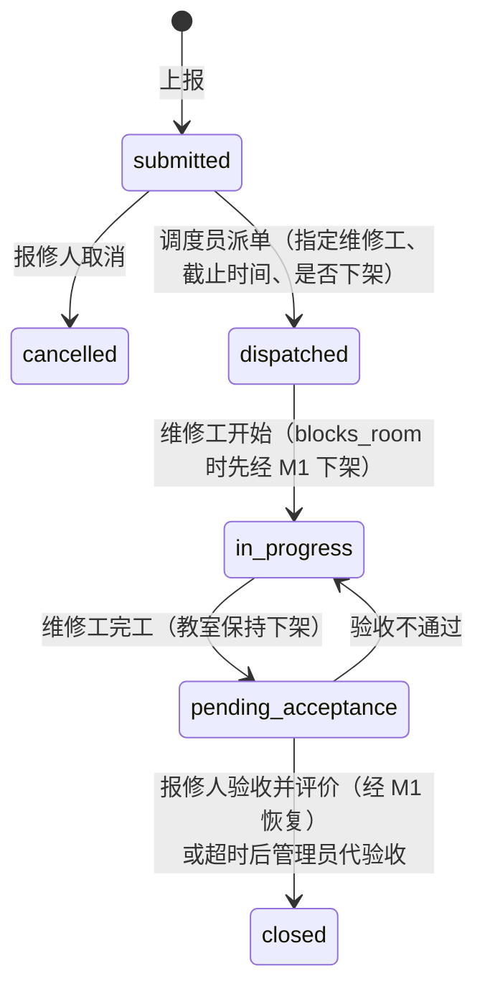

# M3 物业报修工单 设计

| 项目 | 内容 |
|---|---|
| 服务 | `services/m3-repair`，端口 8003，schema `m3` |
| 负责人 | E：工单状态机、派单、维修、验收（E 同时负责 DevOps）；F：通知集成、超时升级（F 同时负责 common 的通知与审计、集成契约） |
| 需求 | REQ-M3-01 至 REQ-M3-10，INT-01 |
| 依赖 | M1（教室信息、下架/恢复）；common（按权限查维修工、升级通知对象） |

## 1. 职责与边界

M3 管理报修工单的完整生命周期。工单引用 M1 的 `room_id`（可选 `seat_id`）。维修期间是否下架整间教室由调度员在派单时决定（`blocks_room`），下架和恢复都通过 M1 完成（[ADR-006](../adr/006-占用冲突时个人预约的处理.md) 说明了被下架时段内已有预约的处理）。

## 2. 数据模型

| 表 | 关键字段 | 说明 |
|---|---|---|
| `work_orders` | reporter_id, room_id, seat_id?, category, description, photos, status, blocks_room, assignee_id, deadline_at, escalation_level, rating, rating_comment, completed_at, closed_by, version | version 乐观锁 |
| `work_order_events` | order_id, at, actor_id?, action, from_status, to_status, note | 时间线；升级、派单、状态变化都记录 |
| `settings` | key, value | 分类、升级规则、代验收时长，默认值见 `schemas.RepairSettings` |
| `outbox` | | |

## 3. 工单状态机

超时升级不改变状态，只增加 `escalation_level` 并通知。

## 4. 业务规则

| 规则 | 说明 |
|---|---|
| 上报 | 教室必须在 M1 存在；分类必须在配置的分类列表中 |
| 取消 | 只有报修人本人、只在 submitted 状态 |
| 派单 | 维修工必须拥有 `repair:work`（调用 common 校验）；deadline_at 必须晚于现在 |
| 开始、完工 | 只有被指派的维修工 |
| 验收 | 报修人本人；或在 `completed_at + admin_accept_after_hours` 之后由 `repair:manage` 代验收（`closed_by` 记录实际操作人） |
| 升级 | 按 `escalation_rules`：工单在某状态停留超过 `timeout_hours` 升级一次；每次升级在时间线留记录，下一次升级从上次升级时间重新计时 |
| 下架时机 | 进入 in_progress 时下架，closed 时恢复；验收不通过退回 in_progress 时保持下架 |

## 5. 接口

记法：`方法 路径 (输入) -> 输出 | 权限`。完整契约见 `contracts/openapi/m3-repair.json`。

| 接口 | 说明 |
|---|---|
| `POST /api/v1/repair/orders (room_id, seat_id?, category, description, photos?) -> WorkOrder` \| `repair:report` | 通知调度员 |
| `GET /api/v1/repair/orders/mine (status?, page, size) -> Page[WorkOrder]` \| `repair:report` | |
| `GET /api/v1/repair/orders/{id} () -> WorkOrder` \| 报修人本人、调度、维修工、管理 | 含时间线 |
| `POST /api/v1/repair/orders/{id}/cancel (reason) -> WorkOrder` \| `repair:report` | |
| `POST /api/v1/repair/orders/{id}/accept (rating 1-5, comment?) -> WorkOrder` \| `repair:report` 或 `repair:manage` | |
| `POST /api/v1/repair/orders/{id}/reject-acceptance (reason) -> WorkOrder` \| `repair:report` | |
| `GET /api/v1/repair/orders (status?, room_id?, assignee_id?, escalated?, page, size) -> Page[WorkOrder]` \| `repair:dispatch` / `repair:work` / `repair:manage` | 维修工只看到自己的 |
| `POST /api/v1/repair/orders/{id}/dispatch (assignee_id, deadline_at, blocks_room) -> WorkOrder` \| `repair:dispatch` | 通知维修工 |
| `POST /api/v1/repair/orders/{id}/start () -> WorkOrder` \| `repair:work` | |
| `POST /api/v1/repair/orders/{id}/complete (note, photos?) -> WorkOrder` \| `repair:work` | 通知报修人验收 |
| `GET/PUT /api/v1/repair/settings (RepairSettings)` \| `repair:manage`（GET 也对 `repair:report` 开放） | |

错误码：`ROOM_NOT_FOUND`(400)、`UNKNOWN_CATEGORY`(400)、`ORDER_STATE_CONFLICT`(409)、`NOT_ASSIGNEE`(403)、`ASSIGNEE_NOT_WORKER`(400)、`ADMIN_ACCEPT_TOO_EARLY`(403)、`UPSTREAM_UNAVAILABLE`(502)。

上报时调用 M1 `get_room` 校验教室：M1 返回 404 `NOT_FOUND` 时转为本模块的 400 `ROOM_NOT_FOUND`；M1 不可达或拒绝调用时为 502。

## 6. 对外调用（`app/clients.py`）

`app/clients.py` 只写业务语义，通信由公共库客户端 `campus_common.clients.m1.M1Client` / `clients.common.CommonClient` 完成（服务身份、超时、错误转换、桩数据）；幂等键由 `clients.idempotency_key()` 生成。客户端与 M1、common 契约的一致性由公共库的契约测试保证。测试中用 `campus_common.testing.record_service_calls()` 记录或模拟远端调用。

| 函数 | 远端接口 | 幂等键 |
|---|---|---|
| `get_room(room_id)` | `GET /internal/v1/rooms/{id}` | — |
| `block_room(order_id, room_id, start_at, reason)` | `POST /internal/v1/blocks`（source=M3_MAINTENANCE，end_at=null） | `m3-order-{id}-block` |
| `release_room(order_id)` | `DELETE /internal/v1/blocks/M3_MAINTENANCE/{id}` | 天然幂等 |
| `users_with_perm(perm)` | common `GET /internal/v1/users` | — |

### 开始维修与验收的步骤

开始维修：检查状态与维修工 → `blocks_room` 为真时调用 `block_room`（失败返回 502，状态不变）→ 一个事务内改状态、写时间线、outbox 发通知与 `m3.workorder.status_changed`。

验收：检查状态与权限 → 曾下架时调用 `release_room` → 一个事务内关闭工单、写评价与时间线、发通知。`release_room` 是幂等的，本地事务失败后重试验收不会出错。

## 7. 定时任务

| 任务 | 频率 | 逻辑 | 状态 |
|---|---|---|---|
| `escalate_overdue` | 5 分钟 | 对每条升级规则：状态匹配、`max(进入该状态时间, 上次升级时间) + timeout_hours <= now` 的工单，SKIP LOCKED 抢行 → escalation_level + 1，写时间线（action=escalate），通知 `notify_perm` 的用户 | 待实现 |
| `relay_outbox` | 2 秒 | 公共库 | 已实现 |

"进入该状态时间"和"上次升级时间"都可以从 `work_order_events` 取得；如果查询变复杂，可以在 `work_orders` 上加 `status_changed_at`、`last_escalated_at` 两列（一次 schema 变更，也是期末"含 schema 变更的部署"的好素材）。

## 8. 实现顺序

| 顺序 | 内容 | 负责 |
|---|---|---|
| 1 | 上报、查询、时间线、取消 | E |
| 2 | 派单、开始、完工、验收状态机（`STUB_CLIENTS=true`） | E |
| 3 | 通知（各状态变化的 outbox 消息与模板） | F |
| 4 | 超时升级任务 | F |
| 5 | 代验收、报修配置 | E |
| 6 | 与 M1 联调，去掉集成测试的 xfail | E、F |

## 9. 待讨论

- 只坏了一个座位时，是否支持只下架该座位而不是整间教室？目前接口只支持整间，扩展需要修改 M1 契约。
- 照片的存储方式（对象存储 / 本地卷 / 只存 URL）。
- 报修人对评价是否可以修改。
