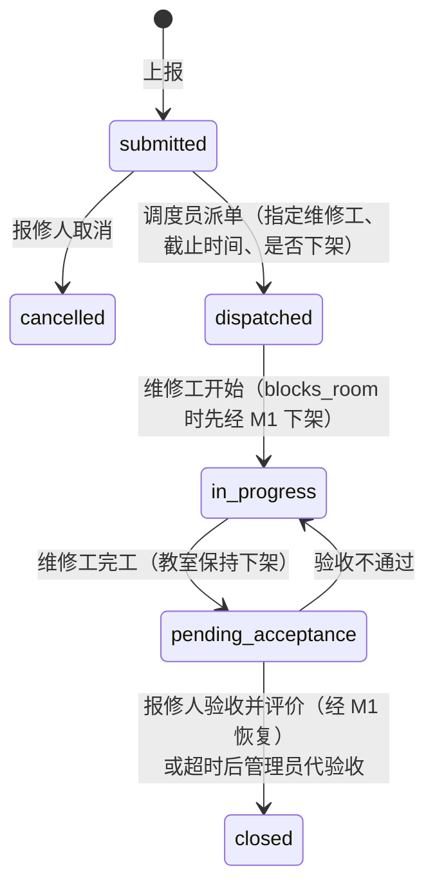

# M3 物业报修工单 设计

| 项目 | 内容 |
|---|---|
| 服务 | `services/m3-repair`，端口 8003，schema `m3` |
| 负责人 | `lanxin-yi`：工单状态机、派单、维修、验收、通知集成、超时升级 |
| 需求 | REQ-M3-01 至 REQ-M3-10，INT-01 |
| 依赖 | M1（教室信息、下架/恢复）；common（派单时按权限查维修工；通知经消息由 common 投递） |

## 1. 职责与边界

M3 管理报修工单的完整生命周期。工单引用 M1 的 `room_id`（可选 `seat_id`）。维修期间是否下架整间教室由调度员在派单时决定（`blocks_room`），下架和恢复都通过 M1 完成（[ADR-006](../adr/006-占用冲突时个人预约的处理.md) 说明了被下架时段内已有预约的处理）。

## 2. 数据模型

| 表 | 关键字段 | 说明 |
|---|---|---|
| `work_orders` | reporter_id, room_id, seat_id?, category, description, photos, status, blocks_room, assignee_id, deadline_at, escalation_level, rating, rating_comment, completed_at, closed_by, status_changed_at, last_escalated_at, block_start_at, version | version 乐观锁；`status_changed_at` / `last_escalated_at` 是超时升级的计时起点；`block_start_at` 是经 M1 下架的起点，首次尝试前写入，重试沿用 |
| `work_order_events` | order_id, at, actor_id?, action, from_status, to_status, note | 时间线；升级、派单、状态变化都记录 |
| `user_snapshots` | id, username, name, dept_id | 工单上出现过的人（报修人、操作人、维修工）的显示信息，参与工单时写入或刷新（来自 token 或派单时 common 返回的维修工）；读接口据此显示姓名，不调用 common。改名后在此人下次操作工单时更新；迁移前已有的工单缺快照时只显示 ID |
| `settings` | key, value | 分类、升级规则、代验收时长，默认值见 `schemas.RepairSettings` |
| `outbox` | | |

## 3. 工单状态机

超时升级不改变状态，只增加 `escalation_level` 并通知。

## 4. 业务规则

| 规则 | 说明 |
|---|---|
| 上报 | 教室必须在 M1 存在；分类必须在配置的分类列表中 |
| 可见性 | 报修人本人、被指派的维修工、`repair:dispatch` / `repair:manage` 可见。先按路由权限码鉴权：没有接口所需权限码的用户无论工单号是什么都是 403；有权限码但看不到该工单时 404 `NOT_FOUND`（不暴露工单是否存在）；看得到但无权执行该操作时 403（`FORBIDDEN` / `NOT_ASSIGNEE`） |
| 取消 | 只有报修人本人（否则 403 `FORBIDDEN`）、只在 submitted 状态 |
| 派单 | 只在 submitted 状态；维修工必须拥有 `repair:work`（调用 common 校验）；deadline_at 必须晚于现在（等于现在也拒绝） |
| 开始、完工 | 只有被指派的维修工（否则 403 `NOT_ASSIGNEE`） |
| 验收 | 报修人本人；或在 `completed_at + admin_accept_after_hours` 之时及之后由 `repair:manage` 代验收（`closed_by` 记录实际操作人）。验收不通过只能由报修人本人（否则 403 `FORBIDDEN`） |
| 升级 | 按 `escalation_rules`：计时起点为 `max(status_changed_at, last_escalated_at)`，起点 + `timeout_hours` 到达（含该时刻）时升级一次；每次升级在时间线留记录，下一次升级从上次升级时间重新计时；状态变化重新计时。每个状态只能配置一条规则（上次升级时间按工单记录，同一状态的多条规则会互相重置计时），重复时保存配置返回 422 `VALIDATION_ERROR` |
| 下架时机 | 进入 in_progress 时下架，closed 时恢复；验收不通过退回 in_progress 时保持下架；`blocks_room=false` 的工单从不调用 M1 |

## 5. 接口

记法：`方法 路径 (输入) -> 输出 | 权限`。完整契约见 `contracts/openapi/m3-repair.json`。

| 接口 | 说明 |
|---|---|
| `POST /api/v1/repair/orders (room_id, seat_id?, category, description, photos?) -> WorkOrder` \| `repair:report` | 通知调度员 |
| `GET /api/v1/repair/orders/mine (status?, page, size) -> Page[WorkOrder]` \| `repair:report` | |
| `GET /api/v1/repair/orders/{id} () -> WorkOrder` \| 报修人本人、调度、维修工、管理 | 含时间线 |
| `POST /api/v1/repair/orders/{id}/cancel (reason) -> WorkOrder` \| `repair:report` | 通知调度员 |
| `POST /api/v1/repair/orders/{id}/accept (rating 1-5, comment?) -> WorkOrder` \| `repair:report` 或 `repair:manage` | 通知维修工 |
| `POST /api/v1/repair/orders/{id}/reject-acceptance (reason) -> WorkOrder` \| `repair:report` | 通知维修工 |
| `GET /api/v1/repair/orders (status?, room_id?, assignee_id?, escalated?, page, size) -> Page[WorkOrder]` \| `repair:dispatch` / `repair:work` / `repair:manage` | 维修工只看到自己的 |
| `POST /api/v1/repair/orders/{id}/dispatch (assignee_id, deadline_at, blocks_room) -> WorkOrder` \| `repair:dispatch` | 通知维修工 |
| `POST /api/v1/repair/orders/{id}/start () -> WorkOrder` \| `repair:work` | 通知报修人 |
| `POST /api/v1/repair/orders/{id}/complete (note, photos?) -> WorkOrder` \| `repair:work` | 通知报修人验收 |
| `GET/PUT /api/v1/repair/settings (RepairSettings)` \| `repair:manage`（GET 也对 `repair:report` 开放） | |

错误码（每个接口的具体错误码写在路由 docstring 中）：

| 错误码 | 状态 | 场景 |
|---|---|---|
| `ROOM_NOT_FOUND` | 400 | 上报时 M1 中没有该教室 |
| `UNKNOWN_CATEGORY` | 400 | 上报的分类不在配置中 |
| `DEADLINE_NOT_FUTURE` | 400 | 派单截止时间不晚于现在 |
| `ASSIGNEE_NOT_WORKER` | 400 | 派单对象没有 `repair:work` |
| `NOT_FOUND` | 404 | 工单不存在，或有接口权限码的用户看不到该工单（没有权限码时先返回 403） |
| `FORBIDDEN` | 403 | 看得到工单但不是报修人（取消、验收、验收不通过） |
| `NOT_ASSIGNEE` | 403 | 看得到工单但不是被指派的维修工（开始、完工） |
| `ADMIN_ACCEPT_TOO_EARLY` | 403 | 管理员代验收时间未到 |
| `ORDER_STATE_CONFLICT` | 409 | 当前状态不允许该操作 |
| `UPSTREAM_UNAVAILABLE` / `UPSTREAM_ERROR` | 502 | M1（上报、开始、验收）或 common（派单）不可达或拒绝调用 |

M1 的其他业务错误（400/404/409）原样返回。

上报时调用 M1 `get_room` 校验教室：M1 返回 404 `NOT_FOUND` 时转为本模块的 400 `ROOM_NOT_FOUND`；M1 不可达或拒绝调用时为 502。

## 6. 对外调用（`app/clients.py`）

`app/clients.py` 只写业务语义，通信由公共库客户端 `campus_common.clients.m1.M1Client` / `clients.common.CommonClient` 完成（服务身份、超时、错误转换、桩数据）；幂等键由 `clients.idempotency_key()` 生成。客户端与 M1、common 契约的一致性由公共库的契约测试保证。测试中用 `campus_common.testing.record_service_calls()` 记录或模拟远端调用。

| 函数 | 远端接口 | 幂等键 |
|---|---|---|
| `get_room(room_id)` | `GET /internal/v1/rooms/{id}` | — |
| `block_room(order_id, room_id, start_at, reason)` | `POST /internal/v1/blocks`（source=M3_MAINTENANCE，end_at=null，start_at=工单的 block_start_at，reason=`报修工单 #{id} 维修中`） | `m3-order-{id}-block` |
| `release_room(order_id)` | `DELETE /internal/v1/blocks/M3_MAINTENANCE/{id}` | 天然幂等 |
| `users_with_perm(perm)` | common `GET /internal/v1/users`（只在派单时校验维修工） | — |

读接口不调用 common（人员姓名来自 `user_snapshots`）；需要通知"拥有某权限的人"时，`NotificationSend` 带 `perm`，由 common 在处理消息时解析收件人，M3 不为查收件人调用 common。

### 开始维修与验收的步骤

开始维修：事务 1 锁定工单、检查维修工与状态，`blocks_room` 为真且 `block_start_at` 为空时写入当前时间并提交 → 调用 `block_room`（start_at 取 `block_start_at`；失败返回 502，状态不变）→ 事务 2 重新锁定并检查，改状态、写时间线、outbox 发通知与 `m3.workorder.status_changed`。M1 按幂等键核对请求内容，下架起点在首次尝试前固定并保存，因此"M1 已下架但响应丢失或本地提交失败"之后的重试发出完全相同的请求，得到首次结果并完成迁移，不会因 `IDEMPOTENCY_KEY_REUSED` 卡在 dispatched。

验收：一个事务内锁定工单、检查状态与权限 → 曾下架时调用 `release_room` → 关闭工单、写评价与时间线、发通知后提交。释放期间工单行保持锁定（最长为一次 M1 调用的超时）：M1 中已释放的占用不能再用同一单号下架，若先释放、再在另一个事务里发现并发的"验收不通过"已把工单退回维修，就无法恢复下架，所以并发操作必须等验收结束。`release_room` 是幂等的，本地事务失败后重试验收不会出错。

### 通知

全部经 outbox 发出（模板登记在 common 的 `app/templates.py`），参数都带 `order_id`、`category`：

| 时机 | template | 收件人 | 其他参数 |
|---|---|---|---|
| 上报 | `repair.reported` | `perm=repair:dispatch` | room（M1 返回的楼宇与教室名） |
| 取消 | `repair.cancelled` | `perm=repair:dispatch`（派单前取消，尚无维修工；报修人是操作者本人，不通知） | reason |
| 派单 | `repair.dispatched` | 维修工 | deadline_at、blocks_room |
| 开始维修 | `repair.started` | 报修人 | blocks_room |
| 完工 | `repair.completed` | 报修人 | note、accept_after_hours |
| 验收不通过 | `repair.rejected` | 维修工 | reason、blocks_room |
| 验收（含代验收） | `repair.accepted` | 维修工 | rating、by_admin |
| 超时升级 | `repair.escalated` | `perm=<规则的 notify_perm>` | status、since（进入该状态的时间）、timeout_hours、level |

## 7. 定时任务

| 任务 | 频率 | 逻辑 | 状态 |
|---|---|---|---|
| `escalate_overdue` | 5 分钟 | 对每条升级规则：`status` 匹配且 `greatest(status_changed_at, last_escalated_at) <= now - timeout_hours`（到期条件写在 WHERE 里，未到期的工单再多也不会挡住到期的），每批 100 条，SKIP LOCKED 抢行 → escalation_level + 1、last_escalated_at = now，写时间线（action=escalate），按权限码通知 `notify_perm`（由 common 解析收件人，common 不可用时升级照常进行） | 已实现 |
| `relay_outbox` | 2 秒 | 公共库 | 已实现 |

"进入该状态时间"和"上次升级时间"保存在 `work_orders.status_changed_at`、`last_escalated_at`（迁移 0002 新增，并从时间线回填已有工单），状态迁移函数与升级任务分别维护。

部署顺序：common 必须先于（或与）本版本 M3 一起部署。M3 的上报、取消、升级通知按权限码寻址（`NotificationSend.perm`），旧版 common 的消费者会忽略 `perm`，这些通知将没有收件人。

## 8. 实现顺序

| 顺序 | 内容 | 负责 |
|---|---|---|
| 1 | 上报、查询、时间线、取消 | `lanxin-yi` |
| 2 | 派单、开始、完工、验收状态机（`STUB_CLIENTS=true`） | `lanxin-yi` |
| 3 | 通知（各状态变化的 outbox 消息与模板） | `lanxin-yi` |
| 4 | 超时升级任务 | `lanxin-yi` |
| 5 | 代验收、报修配置 | `lanxin-yi` |
| 6 | 与 M1 联调，去掉集成测试的 xfail | `lanxin-yi` |

## 9. 待讨论

- 只坏了一个座位时，是否支持只下架该座位而不是整间教室？目前接口只支持整间，扩展需要修改 M1 契约。
- 照片的存储方式（对象存储 / 本地卷 / 只存 URL）。
- 报修人对评价是否可以修改。
